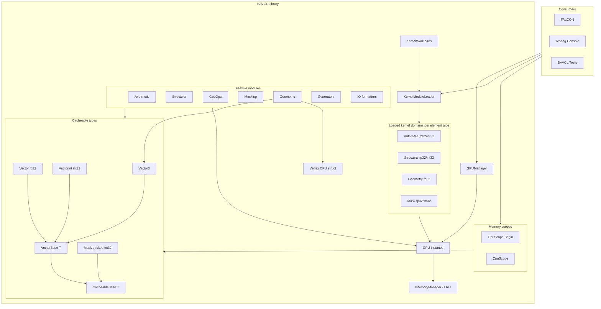
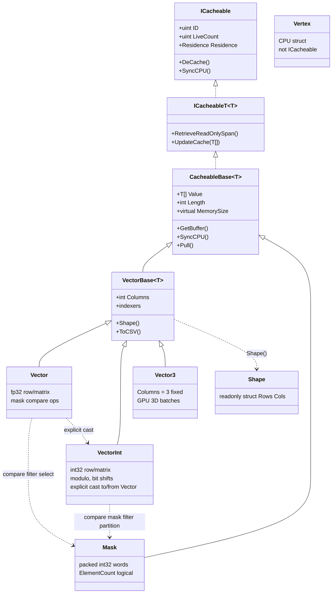
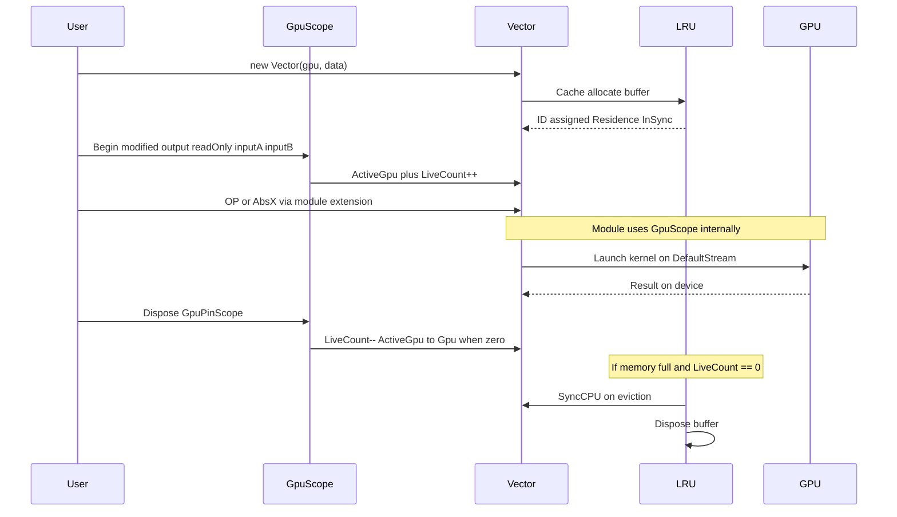
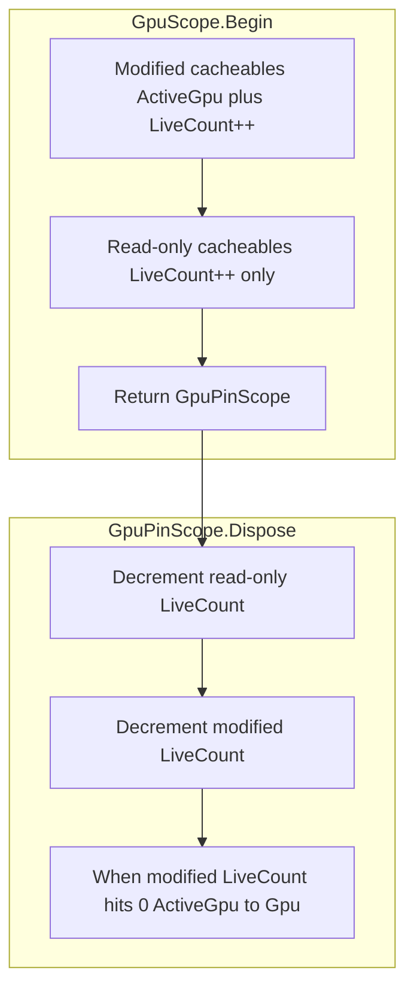
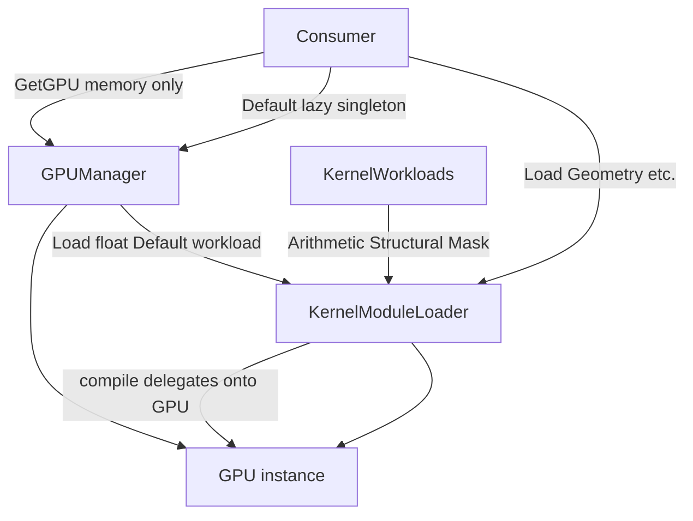
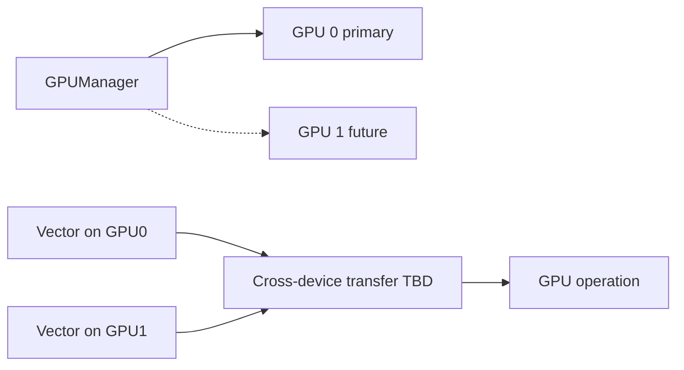

# BAVCL Specification

Authoritative reference for BAVCL behavior and design intent. Documents **current implementation** where verified, plus **roadmap** items explicitly marked as future. When code and spec diverge, reconcile manually — update the spec, change the code, or record an open gap in [Section 17](#17-code-vs-vision-gaps). Neither side wins automatically.

**Version:** Living spec — last reviewed September 2026
**Author:** Marcel Pawelczyk
**Status:** In active development

Document Disclaimer: This document is intended for AI coding tools for reasoning and project alignment. While the contents may be beneficial for human use, the content may be verbose.

---

## Table of Contents

1. [Identity and Scope](#1-identity-and-scope)
2. [Roadmap](#2-roadmap)
3. [Design Principles](#3-design-principles)
4. [Architecture Overview](#4-architecture-overview)
5. [Current Functionality (v0)](#5-current-functionality-v0)
6. [Mask Specification](#6-mask-specification)
7. [Kernel Module System](#7-kernel-module-system)
8. [GPU and Memory](#8-gpu-and-memory)
9. [Code Organization](#9-code-organization)
10. [CPU Execution Path](#10-cpu-execution-path)
11. [Geometry Module](#11-geometry-module)
12. [Astrophysics Module](#12-astrophysics-module)
13. [IO Module](#13-io-module)
14. [Experimental Math](#14-experimental-math)
15. [Testing and Quality](#15-testing-and-quality)
16. [Platform Support](#16-platform-support)
17. [Code vs Vision Gaps](#17-code-vs-vision-gaps)
18. [Related Projects](#18-related-projects)

---

## 1. Identity and Scope

### 1.1 What BAVCL Is

**BAVCL** is a **C# GPU-accelerated numerics library** built on [ILGPU](https://ilgpu.net/) 1.5.3. It provides NumPy-_inspired_ vector math with C#-idiomatic APIs — not a direct NumPy port.

| Attribute        | Value                                                  |
| ---------------- | ------------------------------------------------------ |
| Language         | C# (.NET 10)                                           |
| GPU runtime      | ILGPU 1.5.3 + ILGPU.Algorithms                         |
| Distribution     | Source-only project reference                          |
| Documentation    | [README.md](../README.md), [Documentation/](.)       |
| License          | Source-available custom licence — see [License.txt](../License.txt) and [THIRD_PARTY_LICENSES.md](../THIRD_PARTY_LICENSES.md) |
| Primary consumer | **FALCON** (astrophysics application)                  |

### 1.2 Purpose

General-purpose GPU data-science / numerics for C# projects.

BAVCL accelerates large array operations on CUDA, OpenCL, or CPU backends while keeping smaller workloads on efficient CPU paths (SIMD). Actual backend implementation is dependant on ILGPU's implementation so this statement may not be correct.

### 1.3 Audience

- FALCON project (My Master's project)
- Personal, educational, academic, commercial, and research use per [License.txt](../License.txt) (attribution required for published research and commercial/professional use)

### 1.4 Solution Structure

```
BAVCL.sln
├── README.md               # Quick start, licence summary, doc links
├── Documentation/          # Spec, Features, MigrationGuide, GPGPUKernelGuide
├── BAVCL.csproj            # Core library (net10.0) — sources under Source/
└── Testing Console/        # Manual smoke tests + benchmark entry (not canonical tests)

BAVCL.Tests/                # Sibling repo — canonical xUnit + BenchmarkDotNet home
└── github.com/MPSQUARK/BAVCL.Tests
```

### 1.5 Out of Scope (v1) - Currently

Deferred for v1 — see [§2.1](#21-deferred-and-out-of-scope-v1).

---

## 2. Roadmap

Planned work only. **Shipped behaviour** is documented in §3–§16; open code/spec drift is tracked in [§17](#17-code-vs-vision-gaps). FALCON-driven priorities are tracked in [FALCON `docs/BAVCL_FEATURE_REQUESTS.md`](https://github.com/MPSQUARK/FALCON/blob/main/docs/BAVCL_FEATURE_REQUESTS.md).

### 2.0 Roadmap board

The visual status board is maintained in [Roadmap.md](Roadmap.md). It uses Mermaid’s native `kanban` syntax and is synchronized with the detailed roadmap below and the repository’s GitHub issues. Issue-backed cards link to their corresponding GitHub issues.

### 2.1 Deferred and out of scope (v1)

| Item | Notes |
| ---- | ----- |
| **Matrix** type | Full linear algebra — deferred; 2D `Vector` (`Columns > 1`) covers current matrix-like needs |
| **Table** / dataframe | Columnar named data — deferred |
| **Public NuGet** | Source-only project reference for now |
| **Multi-GPU auto-distribution** | Manual device selection first |

### 2.2 Type system

| Priority | Type | Notes |
| -------- | ---- | ----- |
| 1 | **float64 / double** | `VectorDouble` or dedicated double type |
| 2 | **int64** | e.g. `VectorLong` — no silent buffer widening |
| 3 | **uint** | |
| 4 | **Complex** | `System.Numerics.Complex` if unmanaged constraints allow; else custom struct |

**Open design:** packed-bit mask word layout (benchmark-driven).

### 2.3 Mask

| Item | Detail |
| ---- | ------ |
| **Resize / replace** | [§6.7](#67-resize-planned-future) |
| **Aggregates** | `CountTrue()` / `Any()` / `All()` + `*X` — [§6.8](#68-mask-aggregates) |
| **Index search** | `Where()` / `WhereX()`, `FirstTrueIndex()` / `LastTrueIndex()` + `*X` |
| **Device-side compaction** | Exclusive prefix scan on broadcast flags for `Filter` / `Partition` / `Where` — [§6.6](#66-kernel-strategy) |
| **CPU compaction benchmark** | Compare direct-loop and prior delegate-based implementations across flat, matrix, row-broadcast, size, and mask-density cases; retain only measured improvements |

### 2.4 GPU and memory

| Item | Detail |
| ---- | ------ |
| **Actual GPU memory tracking** | Device-reported usage vs `sizeof(T) × length` estimates — [§8.5](#85-actual-gpu-memory-tracking-exploration) |
| **Multi-GPU** | Cross-device transfer when operands differ — [§4.6](#46-multi-gpu-data-flow-target---wip) |

`Residence` / `GpuScope` already govern when CPU↔GPU sync is required; no separate LRU dirty-flag layer is planned.

### 2.5 Core algorithms (ILGPU / kernels)

| Item | APIs / scope |
| ---- | ------------- |
| **Prefix scan** | `CumSum` / `CumSumExclusive` / `CumProd` / `CumProdExclusive` + `*X` / `*IP` on `Vector` / `VectorInt` — `BAVCL.Modules.Scan` |
| **2D prefix scan (ILGPU)** | Investigate `MultiPassScanKernel` and related APIs in ILGPU `ScanExtensions` for 2D `Vector` / `VectorInt` (row-wise scans today: one `RunSegmentScan` per row in `ScanAlgorithms`). Compare throughput, temp storage, and sync count vs the current loop. |
| **Histogram** | GPU histogram / binning |
| **Segmented sort** | Generalise beyond 2D row `SortAscX` |

### 2.6 Signal processing and reductions (FALCON)

From [FALCON `BAVCL_FEATURE_REQUESTS.md`](https://github.com/MPSQUARK/FALCON/blob/main/docs/BAVCL_FEATURE_REQUESTS.md):

| Priority | Item | FALCON driver |
| -------- | ---- | ------------- |
| High | **GPU FFT / IFFT** | HPF dust determination |
| High | **GPU convolution** (variable Gaussian kernel) | Spectral resolution downgrade |
| Medium | **Sigma-clip reduction** on GPU | Iterative fitter residual clipping |
| Medium | **GPU median / percentile** (order-stat without full sort where possible) | `NormaliseSpec` hot path |
| Medium | **GPU optimisation** (PSO / grid search) | E(B−V) grid search |
| — | **Fused gather+reduce** over variable index pairs per model row | Spectral fit pipeline (not yet specified as public API) |

### 2.7 Kernel domains

| Domain | Notes |
| ------ | ----- |
| **LinearAlgebra** | Dedicated domain beyond `matmul` in Arithmetic |
| **Astrophysics** | FALCON cosmological integrals — [§12](#12-astrophysics-module) |

| Item | Detail |
| ---- | ------ |
| **Kernel module identity** | Replace `(int, Type)` dedup keys (`KernelDomain`, internal `KernelDomainSharedModule`) with a **discriminated union** when the library targets .NET with first-class DUs (planned: .NET 11+). Implementation: `Source/Core/GPU/KernelModules/`. |

### 2.8 Statistics module ergonomics

From [Notes.md](Notes.md): order statistics (`Percentile`, `Median`, …) currently re-sort on each call.

| Proposal | Detail |
| -------- | ------ |
| **Sorted-state flag** | Skip sort when data is already sorted (or expose `IsSorted` / metadata) |
| **Sorted stats scope** | Sort once inside a scope; compute multiple order stats; optional copy vs in-place |

### 2.9 Geometry

| Item | Detail |
| ---- | ------ |
| **Vector3 ↔ Vector conversion** | Reuse GPU buffer ID instead of `Pull()` + reallocate |
| **Vertex ↔ Vector3** | Optimise implicit conversion GPU path |

### 2.10 Astrophysics and FITS

- **FALCON formulas:** cosmological integrals and model variants — expand when integration begins (FALCON spec)
- **FITS I/O:** after core IO polish — [§2.11](#211-io-and-formats)

### 2.11 IO and formats

| Item | Notes |
| ---- | ----- |
| **YAML** | Config + data interchange |
| **FITS**, **NPY**, **HDF5** | FALCON spectral / scientific stacks |
| **Packed mask TXT read** | [§17](#17-code-vs-vision-gaps) #32 |
| **Streamed/chunked write** | Large collections without full in-memory trees |
| **Mixed types per file** | e.g. `Vector` + `Vector3` + `Mask` |
| **Forward-only reader** | `ReadNext` streaming deserialize |

### 2.12 Plotting

Cross-platform debugging plots (low priority) after removal of `System.Drawing` prototype.

### 2.13 Experimental math

Trim `Source/Experimental/TestCls.cs` to one implementation per function, add accuracy tests — [§14](#14-experimental-math).

### 2.14 Platform and tooling

| Item | Detail |
| ---- | ------ |
| **.NET 11 discriminated unions** | Evaluate for operation boilerplate |
| **CI** | `dotnet test` + benchmark regression gate (CodeQL only today) |

---

## 3. Design Principles

### 3.1 C#-Idiomatic API

Inspired by NumPy semantics but shaped for C# conventions: explicit types, properties, operator overloads, extension methods, and `IDisposable` patterns.

### 3.2 Specialized Types

- **Specialized types** where they add value: `Vector` (fp32), `VectorInt` (int32), `Vector3`, `Mask`, etc.
- **`VectorBase<T>`** provides shared GPU/cache infrastructure; there is **no** public generic `Vector<T>` fallback — add a new specialized type when a new element type is needed.

### 3.3 GPU-First / CPU-Explicit Pattern

Most high-throughput paths (operators, `OP`/`IPOP`, broadcast, mask ops) use **GPU kernels** directly. CPU paths exist where explicitly documented (e.g. `Abs()`, `Sum()`, small-array statistics).

| Pattern | Execution | When to use |
| -------- | --------- | ----------- |
| Default operators / `OP` | GPU (ILGPU) | Element-wise and broadcast math on `Vector` |
| Explicit CPU methods | CPU (SIMD where implemented) | `Abs()`, `Sum()`, `Mean()`, debugging, small arrays |
| `X` suffix | GPU kernel | Named GPU entry points (`AbsX`, `RsqrtX`, `ReverseX`, …) |

Examples: `Abs()` (CPU) vs `AbsX()` (GPU); `Sum()` (CPU) vs GPU `OP` for large element-wise work.

### 3.4 Scope-Only GPU Pinning (IMPLEMENTED)

`LiveCount` is managed by `GpuScope.Begin()`. Individual operations use scopes internally; callers wrapping custom kernels should use:

```csharp
using (GpuScope.Begin(modified: output, readOnly: inputA, inputB))
{
    kernel(...);
    gpu.accelerator.Synchronize();
}
```

CPU edits: `CpuScope.Begin<T>(ICacheable<T>, bool syncToGpu)` or `.CpuScope()` / `.CpuScopeAndSync()`. Scope on `ICacheable`; `RetrieveReadOnlySpan` / explicit `EditCpu` on `ICacheable<T>`. See [MigrationGuide.md](MigrationGuide.md).

### 3.5 Pluggable Memory Management

`IMemoryManager` interface allows alternative strategies. Default: LRU auto-cache with configurable memory cap (80% of device memory).

### 3.6 Extension-Method Organization (IMPLEMENTED)

Data types stay thin (`Vector.cs`, `Vector3.cs` — constructors, operators, copy/equals, conversions, indexers). Operations live in `Modules/` as **namespace feature gates**: import only the modules you need and the corresponding extensions appear on `Vector`, `Vector3`, and primitive arrays.

| Namespace | Public API file | Internal helpers |
|-----------|-----------------|------------------|
| `BAVCL.Modules.Arithmetic` | `ArithmeticModule.cs` (`VectorArithmetic`, `VectorArithmeticExtensions`) | `Internal/SumCore.cs`, `Cross.cs`, `ElementWise.cs`, … |
| `BAVCL.Modules.Statistics` | `StatisticsModule.cs` (`VectorStatistics`, `VectorStatisticsExtensions`) | `Internal/DescriptiveStatistics.cs`, `ArrayStatistics.cs`, … |
| `BAVCL.Modules.Structural` | `StructuralModule.cs` (`VectorStructural`, `VectorStructuralExtensions`) | `Internal/Factories.cs`, `ShapeOps.cs`, `Formatting.cs` |
| `BAVCL.Modules.Generators` | `GeneratorsModule.cs` | `Internal/GeneratorsCore.cs` |
| `BAVCL.Modules.Geometric` | `GeometricModule.cs` (`Vector3Geometric`, `Vector3GeometricExtensions`) | `Internal/Vector3Geometry.cs` |
| `BAVCL.Modules.GpuOps` | `GpuOpsModule.cs` | `Internal/Broadcast.cs`, `VectorGpuOps.cs`, `Vector3GpuOps.cs`, `VectorVectorOp.cs`, … |
| `BAVCL.Modules.Masking` | `MaskModule.cs` (`MaskModuleExtensions`) | `Internal/MaskBitwiseOps.cs`, `MaskCpu.cs`, `MaskGpu.cs`, `MaskCompaction*.cs` |
| `BAVCL.Modules.Sorting` | `SortingModule.cs` (`VectorSorting`, `SortingModule`) | `Internal/SortCore.cs`, `ArgsortCore.cs`, `GpuSortingCore.cs`; GPU bridge in `BAVCL.GpuAlgorithms` |
| `BAVCL.Modules.IO` | `IO.cs`, formatters (`JsonFormatter`, `CsvFormatter`, `XmlFormatter`, `TxtFormatter`) | `Internal/IoSchema.cs`, `StructuredCsv.cs`, … |

Primitive-array `Print`, `Sum`, `Average`, `Min`, and `Max` live in **Structural** and **Statistics** modules (the former `Extensions/` folder was merged into `Modules/` — see §9.2).

Each module exposes **one API-catalog file** with C# 14 extension blocks. Static and instance members are split across paired public classes when required (CS0111), e.g. `VectorArithmetic` (static) + `VectorArithmeticExtensions` (instance + `*IP` / `*XIP`). Implementation lives in `Internal/` as `internal static` types — consumers never import or reference them.

```csharp
using BAVCL;                          // core Vector only

using BAVCL.Modules.Arithmetic;       // + Vector.Sum(v), v.CrossX(b), …
using BAVCL.Modules.Statistics;       // + v.Mean(), arr.Min(), …
using BAVCL.Modules.Sorting;          // + v.Sort(SortOrder), v.SortAscIP(), v.SortAscXIP(), v.Argsort(SortOrder), …

Vector.Sum(vec);   // NumPy-style static extension
vec.Sum();         // ndarray-style instance extension
```

`VectorBase<T>.Gpu` is `internal` to enable module access without public exposure.

### 3.7 Source-Only Distribution

Consumers reference the BAVCL project directly. No NuGet packaging planned YET.

### 3.8 Unchecked arithmetic (policy)

**All BAVCL numeric code is unchecked.** Integer and floating-point operations use the storage type end-to-end — there is no silent widening of accumulators (e.g. no `int` → `long` in sum/dot kernels or CPU SIMD paths). Overflow, underflow, and modular wrap are the caller's responsibility, same as NumPy's default integer reductions.

| Rule | Detail |
|------|--------|
| **Storage type = compute type** | `VectorInt` reductions accumulate in `int32`; element-wise `Vector` ops stay `float32`. CPU and GPU float **reductions** (`Sum`, `Dot`, `Var`) use float64 scratch accumulators where compensated summation applies (NumPy-style). |
| **Wider results** | If the value range exceeds the storage type, use a wider type (`Vector` with float, or a future `VectorLong`) — BAVCL does not auto-promote element buffers. |
| **Float error correction** | Float `Sum` / `Dot` / `SumX` / `DotX` always use **Neumaier** compensated summation ([`citations.md`](../citations.md) [9]). CPU widens SIMD chunks to float64 lanes; GPU uses float64 thread-local accumulators and host fold. `Var` / `VarX` use streaming Chan–Golub–LeVeque merge ([2]). |
| **Algorithm design** | Prefer formulations that limit intermediate growth (e.g. `scalar * Sum(v)` for dot-with-scalar) without widening buffers. |

Invalid fixed ranges (e.g. percentile outside [0, 100]) throw `FixedRangeException`. Division by zero length (`Mean` on empty) throws `DivideByZeroException`. Empty sequences for `Min`/`Max` on integers throw `InvalidOperationException`.

### 3.9 Numerical accuracy

**Target:** `float32` results within **6 decimal places** on well-behaved inputs. Future `fp64` types will target proportionally tighter bounds.

**Literature citations:** [`citations.md`](../citations.md) (MNRAS reference layout, numbered [1]–[11]).

| Category | Operations | Method | Typical bound |
|----------|------------|--------|---------------|
| EC reductions | `Sum`, `SumX`, `Dot`, `DotX` | Widened SIMD Neumaier | abs error &lt; 10⁻⁵ on 10⁶ × 0.1 stress |
| Variance | `Var`, `SampleVar`, `Std`, `SampleStd`, `VarX`, `SampleVarX`, `StdX`, `SampleStdX` | Streaming CGL on SIMD blocks | &lt; 10⁻⁵; stable on large-mean-offset data. `Var`/`VarX` = population (÷N); `SampleVar`/`SampleVarX` = sample (÷N−1). |
| Order-preserving | `Min`, `Max`, `Range`, `MinMax` | SIMD min/max | Exact (bit-identical) |
| Order stats | `Percentile`, `Median`, quartiles | Sort + linear interpolation | &lt; 10⁻⁵ |
| Integer | `VectorInt` sum, mean | Unchecked `int32` | Exact until overflow |

#### fp32 precision limits (debugging aid)

`float32` has ~7 significant decimal digits. If values differ only in digits beyond that magnitude, they **round to the same float** and variance/sum correctly returns 0 spread:

- **Symptom:** `Var` ≈ 0 but you expected spread on values like `1e9+1`, `1e9+2`, …
- **Cause:** At magnitude 10⁹, adjacent integers are not representable in `float32` (ULP ≫ 1).
- **Fix:** Use a wider type when it exists (`fp64`), centre/scaling before stats, or subtract a baseline on CPU before upload.

#### Production algorithms and literature survey

**Sum / dot (CPU):** widened SIMD Neumaier with float64 lane accumulators. **~4×** naive SIMD at N = 10⁶; **0** abs error on 10M×0.1f stress.

**Variance (CPU):** SIMD block moments + streaming Chan–Golub–LeVeque merge; Welford tail for remainders. Stable on large-mean-offset data.

**Surveyed 2020–2026 (no change adopted):** see [`citations.md`](../citations.md) entries [3], [4], [8], [10]. None beat production on scalar float32 speed **and** our accuracy target.

Implementation: `Source/Core/Helpers/Numerics/`. Accuracy report: `dotnet run -c Release --project BAVCL.Benchmarks -- --sum-accuracy-report`.

CPU and GPU `*X` APIs are parity-tested to these bounds. See [MigrationGuide.md § Numerical accuracy](./MigrationGuide.md#numerical-accuracy-float32).

---
## 4. Architecture Overview

### 4.1 High-Level Component Diagram



**Layout (repo):** types in `Source/Types/`; operations in `Source/Modules/*`; GPU core in `Source/Core/GPU/` and `Source/Core/Memory/`; kernels under `Source/Core/GPU/Kernels/{Arithmetic,Structural,Geometry,Mask}/` (each domain has a `.Float32.cs` file and, where implemented, an `.Int32.cs` counterpart).

### 4.2 Type Hierarchy



**`CacheableBase<T>`** is the abstract base for **any GPU-cacheable data** (`Source/Core/Bases/CacheableBase.cs`). It defines:

- GPU caching lifecycle (`Cache`, `DeCache`, `SyncCPU`, `GetBuffer`, `UpdateCache`)
- Coherence state (`ID`, `LiveCount`, `Residence`, `Length`)
- Host-side backing store (`Value[]`)
- `virtual MemorySize` — default `sizeof(T) × Length`; overridable for packed types (e.g. `Mask`)
- Span/read APIs (`Pull`, `RetrieveReadOnlySpan`, `ToArray`, `CpuScope` host)

**`VectorBase<T>`** extends `CacheableBase<T>` with vector shape and indexing:

- Shape parameters (`Columns`, `RowCount`, `Shape()`)
- Indexers and coordinate access (`GetAt`, `SetAt`)
- `IIO` surface (`Print`, `ToCSV` forwarder to Structural module)

Operations (`Sum`, `Mean`, `Min`, `Max`, etc.) live in **`Modules/`** — not on the type hierarchy.

It is **not** a "CPU mirror" — `CacheableBase` owns memory; `VectorBase` owns vector semantics shared by all vector kinds.

### 4.3 GPU Lifecycle



### 4.4 GpuScope Flow

`GpuScope` (`Source/Core/Memory/Scopes/GpuScope.cs`) returns a `GpuPinScope` that pins `ICacheable` instances for the duration of a `using` block. Library GPU operations call `GpuScope.Begin` internally; custom kernels should do the same. **Prefer** `GpuScope.Begin(modified, readOnly…)` when all buffers exist — avoid stacking separate `BeginReadOnly` + `Begin(modified)` for the same launch.



| API | Use case |
| --- | -------- |
| `GpuScope.Begin(modified)` | Single output buffer |
| `GpuScope.Begin(modified, readOnly...)` | Output plus one or more read-only inputs |
| `GpuScope.Begin(modified[], readOnly[])` | Multiple outputs and inputs |
| `GpuScope.BeginReadOnly(readOnly...)` | Read-only pin (e.g. input-only kernel) |

Nested scopes are supported via `Interlocked` refcount on `LiveCount`. Pair with `CpuScope` / `.CpuScope()` for host-side edits (`Source/Core/Memory/Scopes/CpuScope.cs`).

### 4.5 Kernel Module Registration (IMPLEMENTED)



GPU creation and kernel loading are **separate steps**. Each `GPU` instance is configured independently via `KernelModuleLoader.Load<T>(gpu, domains)`. There is no implicit domain — if no modules are loaded, kernel delegates throw `KernelNotCompiledException`.

Registered domains in `KernelModuleLoader` today: **Arithmetic**, **Structural**, **Geometry**, **Mask**, **Scan**, **Sorting**, and **Statistics** (for `float` and/or `int` per pair). **LinearAlgebra** and **Astrophysics** are enum placeholders only.

`GPUManager.Default` loads `KernelWorkloads.Default` (Arithmetic + Structural + Mask). **Scan**, **Sorting**, and **Statistics** are opt-in via `KernelWorkloads.Scan`, `KernelWorkloads.Sorting`, and `KernelWorkloads.Statistics`. `KernelWorkloads.Geometry` adds Geometry on top of Default.

### 4.6 Multi-GPU Data Flow (Target - WIP)

**Current:** `GPUManager.Default` is a single lazy GPU; `GetGPU()` can create additional instances, but cross-device transfer is not implemented.



---
## 5. Current Functionality (v0)

This section documents **what exists in code today**. See [Section 17](#17-code-vs-vision-gaps) for open gaps and reconciliation status.

### 5.1 Entry Points

| Entry                       | Location                            | Role                                        |
| --------------------------- | ----------------------------------- | ------------------------------------------- |
| `GPUManager.Default`        | `Source/Core/GPU/Services/GPUManager.cs` | Singleton lazy GPU + Default workload     |
| `GPUManager.GetGPU()`       | same                                | Create bare GPU (no kernels) with memory cap |
| `GPUManager.GetGPU<TMem>()` | same                                | GPU with custom `IMemoryManager`          |
| `KernelModuleLoader.Load<T>()` | `Source/Core/GPU/KernelModules/`  | Compile selected domains for element type `T` onto a GPU |
| `KernelModuleLoader.LoadAll<T>()` | same                          | Compile every registered domain for `T`   |
| `KernelWorkloads.Default` / `.Geometry` / `.Scan` / `.Sorting` / `.Statistics` | same | Named domain bundles — see [§7.4](#74-workloads) |

### 5.2 Vector (float32)

**Type:** `BAVCL.Vector` — `sealed partial class : VectorBase<float>`
**Type file:** `Source/Types/Vector.cs` (constructors, operators, mask/compare surface, copy/equals, conversions, indexers)
**Operations:** extension modules — Arithmetic, Statistics, Structural, Generators, GpuOps, Masking (see §3.6)

#### 5.2.1 Construction and Properties

| Method / Property                             | Description                                |
| --------------------------------------------- | ------------------------------------------ |
| `Vector(GPU, float[], columns=0, cache=true)` | Construct from array; `columns=0` row 1D (default), `1` column, `N>1` matrix |
| `Vector(GPU, int length, columns=0)`          | Uninitialized length (may contain garbage) |
| `Copy(cache=true)`                            | Deep copy                                  |
| `Equals(Vector)`                              | Element-wise equality after CPU sync       |
| `Shape()`                                     | `Shape` struct (`Rows`, `Cols`)            |
| `Flatten()`                                   | Set `Columns = 0` (1D row storage)         |
| `ToVector3()`                                 | Convert when length % 3 == 0               |

#### 5.2.2 Statistical Properties

Implemented in `BAVCL.Modules.Statistics` (`StatisticsModule`, `VectorStatistics`). Arithmetic `Sum()` / `SumX()` live in `BAVCL.Modules.Arithmetic`.

| Method | CPU | GPU (`X`) | Implementation / notes |
| ------ | --- | --------- | ---------------------- |
| `Sum()` | ✓ | — | Widened SIMD Neumaier (float64 scratch); always EC |
| `SumX()` | — | ✓ | Grouped Neumaier kernel (float64 thread accumulators + host fold); `VectorInt` accumulates in `int32` (unchecked) |
| `Mean()` | ✓ | — | `Sum() / Length` |
| `MeanX()` | — | ✓ | `SumX() / Length` |
| `Var()` | ✓ | — | **Population** variance (σ², ÷N). Streaming CGL on SIMD blocks + Welford tail — **always CPU** |
| `SampleVar()` | ✓ | — | **Sample** variance (s², ÷N−1). Same accumulator as `Var()`; requires length ≥ 2 |
| `VarX()` | — | ✓ | **Population** variance on GPU; grouped CGL reduce |
| `SampleVarX()` | — | ✓ | **Sample** variance on GPU; same kernel as `VarX()` |
| `Std()` / `StdX()` | ✓ | ✓ | √`Var` / √`VarX` (population) |
| `SampleStd()` / `SampleStdX()` | ✓ | ✓ | √`SampleVar` / √`SampleVarX` |
| `Min()`, `Max()` | ✓ | — | CPU SIMD via `CpuSimdReduce` |
| `MinX()`, `MaxX()` | — | ✓ | ILGPU `MinFloat`/`MaxFloat`/`MinInt32`/`MaxInt32` |
| `Range()` | ✓ | — | `Max - Min` |
| `RangeX()` | — | ✓ | Fused grouped min/max kernel (one launch) |
| `All()` | ✓ | — | CPU SIMD zero-check |
| `AllX()` | — | ✓ | Grouped non-zero scan (scalar flags; no full `Mask` buffer) |
| `Dot()` | ✓ | — | CPU SIMD dot (`Arithmetic` module); Neumaier EC; scalar form uses `scalar * Sum` |
| `DotX()` | — | ✓ | Grouped compensated `dotReduce` kernel (Statistics domain) |
| `Percentile()`, `Median()`, `Quartile1()`, `Quartile3()`, `Iqr()` | ✓ | — | CPU `SortAsc` + linear interpolation |
| `PercentileX()`, `MedianX()`, `Quartile1X()`, `Quartile3X()`, `IqrX()` | — | ✓ | GPU `SortAscX` + CPU index read |

Load Statistics: `KernelModuleLoader.Load<float>(gpu, KernelWorkloads.Statistics)` and `KernelModuleLoader.Load<int>(gpu, KernelWorkloads.Statistics)`.

#### 5.2.3 Factory Methods

Implemented in `BAVCL.Modules.Structural` (`VectorStructural`) and `BAVCL.Modules.Generators` (`GeneratorsModule`).

| Method                                       | Description          |
| -------------------------------------------- | -------------------- |
| `Zeros(gpu, length, columns)`                | Zero-filled vector   |
| `Ones(gpu, length, columns)`                 | Ones-filled          |
| `Fill(gpu, value, length, columns)`          | Constant fill        |
| `Arange(gpu, start, end, interval, columns)` | Range with step      |
| `Linspace(gpu, start, end, steps, columns)`  | Evenly spaced values |
| `GeneratorsModule.Arange(...)` / `Linspace(...)` static | Return `float[]` only |

#### 5.2.4 Element-wise and Unary Operations

| Operation  | CPU               | GPU | In-place (CPU) | In-place (GPU) |
| ---------- | ----------------- | --- | -------------- | -------------- |
| Abs        | `Abs`             | `AbsX` | `AbsIP` | `AbsXIP` |
| Reciprocal | —                 | `ReciprocalX` | — | `ReciprocalXIP` |
| Rsqrt      | `Rsqrt`           | `RsqrtX` | `RsqrtIP` | `RsqrtXIP` |
| Reverse    | `Reverse`         | `ReverseX` | `ReverseIP` | `ReverseXIP` |
| Diff       | —                 | `DiffX` | — | `DiffXIP` |
| NanToNum   | —                 | `NanToNumX` | — | `NanToNumXIP` |
| Normalise  | —                 | `NormaliseX` | — | `NormaliseXIP` |
| Log        | —                 | `LogX` (`GpuOpsModule`) | — | `LogXIP` |

#### 5.2.5 Binary Operations and Operators

**Migration:** See [`MigrationGuide.md`](MigrationGuide.md) for naming (`_IP` → `IP`, GPU `X` alignment) and breaking changes to `Columns`, `OP`/`IPOP`, `ReduceOPX`, and `Matrix*X`.

Binary `+`, `-`, `*`, `/`, `^` operator overloads use **NumPy-style element-wise broadcast** via `OP()` / `IPOP()`. Three separate API families exist for different semantics:

| Family | Methods | Semantics |
| ------ | ------- | --------- |
| **Broadcast (default)** | `OP`, `IPOP`, operators | NumPy element-wise broadcast via `broadcastOpKernel` / `broadcastOpKernelIP` — **GPU-only; no `X` suffix** |
| **Matrix calculator** | `MatrixAddX`, `MatrixSubtractX`, `MatrixDivideX`, `MatrixPowX`, `MatrixMultiplyX`, `CrossX` | Strict 2D rules: same shape for add/sub/div/pow; inner-dimension match for multiply |
| **Row reduction** | `ReduceOPX` | `reduceRowOpKernel` — one output per matrix row (not broadcast, not matmul) |

| Method                        | Description                              |
| ----------------------------- | ---------------------------------------- |
| `OP(vecA, vecB, Operations)`  | NumPy broadcast element-wise (GPU)       |
| `OP(vec, scalar, Operations)` | Vector-scalar (GPU)                      |
| `IPOP(vecB, Operations)`      | In-place broadcast when left shape equals output shape |
| `IPOP(scalar, Operations)`    | In-place vector-scalar                   |
| `MatrixAddX` / `MatrixSubtractX` / `MatrixDivideX` / `MatrixPowX` | Identical `(M,N)` matrices, element-wise (GPU) |
| `MatrixMultiplyX` / `CrossX`    | Matrix multiply `(M,K) × (K,N)` — `CrossX` is the primary name; `MatrixMultiplyX` is an alias |
| `ReduceOPX(vector, matrix, op)` | 1D row coefficient (`Columns=0`), length == matrix columns; allocates output length == matrix rows |
| `Dot(vecA, vecB)`             | Scalar inner product (equal length only; uses `OP` + CPU `Sum`) |

**`Operations` enum** (`Source/Core/Enums/Operations.cs`): `multiply`, `add`, `subtract`, `divide`, `pow`, `flipDivide`, `flipSubtract`, `flipPow`, `differenceSquared`, `distance`, `magnitude`.

**Storage (`Columns`):**

| `Columns` | Logical shape | Example |
| --------- | ------------- | ------- |
| `0` (default) | `(1, N)` row | `[1,2,3,4]` |
| `1` | `(N, 1)` column | `[[1],[2],[3],[4]]` |
| `N > 1` | `(Length/N, N)` matrix | `[[1,2,3],[4,5,6]]` |

`RowCount()` and `Shape()` derive from `Columns` and `Length` as above. `Is1D()` is true when `Columns == 0` or `Columns == 1` (both lay out as one global, non-row-segmented sequence); `Is1DRowVector()` narrows to `Columns == 0` alone; `Is2D()` is true when `Columns > 1`.

**No in-place row reduce:** `ReduceIPOP` is intentionally omitted. Row reduction reads a full coefficient vector (`Length == matrix.Columns`) and writes one scalar per row (`Length == matrix.RowCount()`). A single buffer cannot satisfy both layouts except on square matrices, and even then the row-wise kernel reads every coefficient element on each thread while writing row outputs into the same buffer — unsafe GPU aliasing without a coefficient snapshot. A column-wise per-thread scheme would avoid aliasing but would not implement shared-coefficient row reduction and would harm row-major coalescing. Use allocating `ReduceOPX` instead.

**Broadcasting:** Operand shapes are resolved host-side into `BroadcastStrides` (row stride, column stride) where a length-one axis gets stride `0`. `broadcastOpKernel` / `broadcastOpKernelIP` map each output element to operand indices via multiply-add with no shape tests on device; only the operation stays specialized. Incompatible shapes throw `ShapeMismatchException`. `IPOP` throws `PerformanceException` (prefix: *This operation will lead to degraded performance:*) when the left operand would need resizing.

**Note:** `Vector3.CrossX` is a separate optimised 3D geometric kernel — not related to `Vector.CrossX` (matrix multiply).

**Note:** Unary `+` operator currently calls `AbsX` (likely unintentional — see §17 #21).

#### 5.2.5a Mask and comparison operators (on `Vector`)

Defined on `Source/Types/Vector.cs`; GPU kernels in `BAVCL.Modules.Masking`. See [§6.5](#65-vector-comparisons--mask-gpu) for full semantics.

| Surface | Examples |
| ------- | -------- |
| Compare → `Mask` | `CompareEqualsX`, `CompareNotEqualsX`, `CompareX`, `>`, `<`, `>=`, `<=` |
| Filter / select | `vector & mask` → `MaskX`, `vector \| mask` → `FilterX`, `vector / mask` → `PartitionX`, `vector[mask]` → `FilterX` |

#### 5.2.6 Structural Operations

| Method                                   | Description                                 |
| ---------------------------------------- | ------------------------------------------- |
| `TransposeX` / `TransposeXIP`            | GPU transpose kernel                        |
| `Dot(vecA, vecB)` / `Dot(scalar)`        | Dot product (scalar; uses `OP` + CPU `Sum`) |
| `Concat(vecA, vecB)` / `ConcatIP`        | Row-axis concatenate (CPU)                  |
| `ConcatColumnX` / `ConcatColumnXIP`      | Column-axis concatenate (GPU)               |
| `Append` / `Prepend`                     | Vector append (CPU allocating)              |
| `Merge`                                  | Merge vectors (CPU)                         |
| `GetSliceAsVector` / `GetSliceAsArray`   | Row slice (CPU)                             |
| `GetSliceAsVectorX` / `GetSliceAsArrayX` | Column slice (GPU)                          |
| `GetColumnAsVectorX` / `GetColumnAsArray`| Column extraction (GPU)                     |
| `GetRowAsVector` / `GetRowAsArray`       | Row extraction (CPU)                        |
| `TransferBuffer`                         | Copy GPU buffer reference to another vector |
| `All()`                                  | True if no zero values                      |

#### 5.2.7 Output

| Method                          | Description      |
| ------------------------------- | ---------------- |
| `Print(decimalplaces, syncCPU)` | Console output   |
| `ToStr(decimalplaces, syncCPU)` | Formatted string |
| `ToCSV()` (via `VectorBase`)    | CSV string       |

#### 5.2.8 Sorting (`BAVCL.Modules.Sorting`) — `Vector` and `VectorInt`

**Naming convention** (library-wide standard — see [Features.md](Features.md)):

| Suffix     | Meaning                                                                                | Example         |
| ---------- | --------------------------------------------------------------------------------------- | --------------- |
| *(none)*   | Allocating — returns a new `Vector` / `VectorInt`; input unchanged                      | `SortAsc()`     |
| `IP`       | In-place — mutates the receiver (sort), or writes into a caller-provided buffer (argsort) | `SortAscIP()`   |
| `X`        | GPU, allocating                                                                          | `SortAscX()`    |
| `XIP`      | GPU, in-place                                                                            | `SortAscXIP()`  |

Order is abbreviated `Asc` / `Desc` (not `Ascending` / `Descending`); `Kern` marks device kernel entry points and their delegate fields.

Full API matrix, 12 methods × {`Sort`, `Argsort`} = 24 methods per type (`Vector`, `VectorInt`), mirrored as static extensions (`VectorSorting`) and instance extensions (`SortingModule`):

| Operation | CPU allocating | CPU in-place | GPU allocating | GPU in-place |
| --------- | --------------- | ------------- | ---------------- | -------------- |
| Sort      | `Sort(order)` / `SortAsc()` / `SortDesc()` | `SortIP(order)` / `SortAscIP()` / `SortDescIP()` | `SortX(order)` / `SortAscX()` / `SortDescX()` | `SortXIP(order)` / `SortAscXIP()` / `SortDescXIP()` |
| Argsort   | `Argsort(order)` / `ArgsortAsc()` / `ArgsortDesc()` | `ArgsortIP(indices, order)` / `ArgsortAscIP(indices)` / `ArgsortDescIP(indices)` | `ArgsortX(order)` / `ArgsortAscX()` / `ArgsortDescX()` | `ArgsortXIP(indices, order)` / `ArgsortAscXIP(indices)` / `ArgsortDescXIP(indices)` |

Notes:

- `Sort` is per-row for `Is2D()` vectors (`Columns > 1`); global for `Is1D()` (`Columns == 0` or `1`).
- `Argsort` never mutates the source values, on either CPU or GPU, for both the allocating and in-place forms.
- `ArgsortIP` / `ArgsortXIP` require the caller-provided `indices` buffer to match the source's shape (`Length` and `Columns`); mismatches throw `ShapeMismatchException`.
- GPU `SortX` / `SortXIP` / `ArgsortX` / `ArgsortXIP` require the **Sorting** kernel domain on the target `GPU` before use. Load via `KernelModuleLoader.Load<float>(gpu, KernelWorkloads.Sorting)` and `KernelModuleLoader.Load<int>(gpu, KernelWorkloads.Sorting)` (or `KernelDomain.Sorting` directly). Unloaded delegates throw `KernelNotCompiledException` — same contract as other GPU modules (§7).
- GPU float sort/argsort maps floats to sortable `int` keys (`floatToSortableIntKern` / `sortableIntToFloatKern`), then reuses the int radix path.
- GPU prefix scan (`CumSumX`, `CumProdX`, etc.) and GPU int radix sort/argsort use **ILGPU.Algorithms** delegates cached in `AlgorithmProviders` (one compiled delegate per variant per `GPU`; compilation on first use). Load **Scan** / **Sorting** via `KernelModuleLoader` where other kernels in those domains are required; scan/radix delegates do not depend on a separate enable step. These handles are **not** in `MemoryUsed`. **Temporary** storage is computed per call (`ComputeScanTempStorageSize`, `ComputeRadixSortTempStorageSize`, `ComputeRadixSortPairsTempStorageSize`) and rented from `BufferPools`.
- **Radix temp alignment:** ILGPU reinterprets radix temp storage as wider structs, so it must start on a 16-byte boundary (4 `int` elements). When temp is carved from a shared scratch buffer (sort keys followed by radix temp), the temp offset is the key length rounded up to a multiple of 4 (`SortAlgorithms.RadixTempOffset`); an unaligned offset silently mis-sorts for lengths that are not a multiple of 4 (observed at `N = 100_001`). This applies to the keys-only (`Sort1D`, float) and key/value (`Argsort1D`) radix sorts alike. Delegates themselves are size-independent and cached; only temp storage is sized per call.
- **Dispatch layering:** `GpuSortingCore` is the single dispatch layer. It branches `Is2D()` vs 1D once and calls the `SortAlgorithms` leaf (`Sort1D*`, `Sort2D*`, `Argsort1D*`, `Argsort2D*`) directly; leaves open their own `GpuScope` and do not branch on shape. Allocating argsort leaves pin the input (`BeginReadOnly`) before creating `indices` so the allocation's LRU pass cannot evict it.

### 5.3 Vector3 (GPU 3D)

**Type:** `BAVCL.Geometric.Vector3` — `sealed partial class : VectorBase<float>`, `Columns` fixed at 3
**Type file:** `Source/Modules/Geometric/Types/Vector3.cs`
**Operations:** Geometric, GpuOps, Structural, Statistics, Arithmetic modules (see §3.6)

| Category     | Methods                                                                            |
| ------------ | ---------------------------------------------------------------------------------- |
| Construction | `Vector3(gpu, float[])`, `Vector3(gpu, int length)` — length must be multiple of 3 |
| Conversion   | `ToVector()`, `ToVector(columns)` — uses `Pull()` today (buffer reuse TBD — §17 #22) |
| Factory      | `VectorStructural.Zeros(gpu, length)`, `Fill(gpu, value, length)`                  |
| Operators    | `+`, `-`, `*`, `/`, `^` with Vector3 and float (GPU via `GpuOpsModule`)            |
| Geometry     | `Cross(vecA, vecB)`, `Dot(vecA, vecB)`, `Magnitude()`, `Magnitude(vecA, vecB)`, `Distance(vec)` — `LengthMismatchException` on size mismatch |
| Per-row ops  | `VOP(vec, op)`, `VOP(vecA, vecB, op)` → returns `Vector` of per-row results        |
| Indexing     | `this[int row, Coord]`, `GetAt`, `SetAt` (reads sync via `RetrieveReadOnlySpan`; writes use `CpuScope`) |
| Concat       | With `Vector3`, `Vertex`, arrays, lists                                            |
| Access       | `AccessRow(vec, row)`                                                              |
| Copy         | `Copy()`                                                                           |
| Stats        | `Mean()`, `Min()`, `Max()`, `Range()` (Statistics); `Sum()` (Arithmetic) — **scalar reductions over all float components** in storage (not per-`Vector3` row); see [§11.1](#111-vector3--permanent-specialized-type) |

### 5.4 Vertex (CPU 3D)

**Type:** `BAVCL.Geometric.Vertex` — `struct`, CPU-only, complementary to `Vector3`
**File:** `Source/Modules/Geometric/Types/Vertex.cs`

| Category            | Methods                                                              |
| ------------------- | -------------------------------------------------------------------- |
| Construction        | `(x,y,z)`, `(float[])`, `(double x,y,z)`                             |
| Presets             | `UP`, `DOWN`, `FORWARD`, `BACKWARD`, `LEFT`, `RIGHT`                 |
| Operators           | `+`, `-`, `*`, `/` with Vertex and float                             |
| Math                | `Magnitude`, `Distance`, `Dot`, `Cross`, `UnitVector`, `Fract`       |
| Rendering           | `Reflect`, `Refract`, `NormalReflectance`, `Aces_approx`, `Reinhard` |
| Component setters   | `SetX`, `SetY`, `SetZ`                                               |
| Implicit conversion | From`Vector3` (pulls full array)                                     |

### 5.5 GPU Infrastructure

#### 5.5.1 GPU Class

`BAVCL.GPU` — wraps `Accelerator` + `IMemoryManager`. Provides allocation, buffer lookup, GC, kernel delegates, `Dispose()`.

#### 5.5.2 Compiled Kernels

Kernels are loaded selectively via `KernelModuleLoader` (see §7). Each domain file under `Source/Core/GPU/Kernels/` holds its own `partial GPU` delegate fields, load method, and kernel bodies.

| Kernel                                    | Domain      | Purpose                                         |
| ----------------------------------------- | ----------- | ----------------------------------------------- |
| `appendKernel`                            | Structural  | Append rows                                     |
| `getSliceKernel`                          | Structural  | Slice extraction                                |
| `reverseKernel`                           | Structural  | Reverse in-place                                |
| `transposekernel`                         | Structural  | Matrix transpose                                |
| `nanToNumKernel`                          | Arithmetic  | Replace NaN/Inf                                 |
| `a_opFKernel` / `s_opFKernel`             | Arithmetic  | Binary ops (array/scalar)                       |
| `a_FloatOPKernelIP` / `s_FloatOPKernelIP` | Arithmetic  | In-place binary ops                             |
| `broadcastOpKernel` / `broadcastOpKernelIP` | Arithmetic  | NumPy-style element-wise broadcast              |
| `reduceRowOpKernel`                       | Arithmetic  | Row-wise vector-matrix reduction (`ReduceOPX`)   |
| `matmulKernel`                            | Arithmetic  | Matrix multiply (`Cross` / `MatrixMultiply`)    |
| `diffKernel`                              | Arithmetic  | Adjacent difference                             |
| `absKernel`                               | Arithmetic  | Absolute value                                  |
| `rcpKernel`                               | Arithmetic  | Reciprocal                                      |
| `rsqrtKernel`                             | Arithmetic  | Reciprocal sqrt                                 |
| `LogKernel`                               | Arithmetic  | Log with configurable base                      |
| `crossKernel`                             | Geometry    | 3D cross product                                |
| `normaliseKernel`                         | Geometry    | Per-row normalisation                           |
| `simdVectorKernel`                        | Geometry    | Per-row 3-wide ops (Vector3 magnitude/distance) |
| Mask kernels (8)                          | Mask        | See [§6.6](#66-kernel-strategy)                 |

**GpuOps module dependency:** `Modules/GpuOps` requires **Arithmetic** kernels loaded for the element type in use — `Load<float>(...)` for `Vector`, `Load<int>(...)` for `VectorInt` (broadcast, element-wise, row reduce).

**Mask module dependency:** `Modules/Masking` requires **Mask** domain kernels (`KernelWorkloads.Default` includes Mask).

**Never loaded:** `TestSQRTKernel`, `TestMYSQRTKernel` in `Kernels/Experimental/` — no module provides them, so they throw `KernelNotCompiledException` if called.

#### 5.5.3 Pooled buffer entities (`BufferPool`)

`BufferPools.For(gpu)` returns a per-device **`BufferPool`** with **`Int`** and **`Float`** lanes. `pool.Int.Rent(length)` returns a disposable **`BufferEntity<int>`** (float via `pool.Float.Rent`) — a pooled GPU buffer spirit with an LRU ID on an internal slot. Buffers are bucketed by power-of-two capacity, returned to the pool on `Dispose`, and evicted by the LRU only when GPU memory is needed elsewhere.

**Necromancy glossary** (intentional naming for the possess/banish lifecycle):

| Term | Type | Meaning |
|------|------|---------|
| **Entity** | `BufferEntity<T>` | Pooled GPU buffer rental |
| **Vessel** | `Vessel<TCacheable>` | Empty domain shell (`ID == 0`) from `Mask.CreateVessel(gpu, …)`, etc. — GPU required at creation |
| **Possess** | `entity.Possess(vessel)` | Transfers buffer ID from entity slot → vessel |
| **Soul** | `possession.Soul` | Inhabited `Mask` / `VectorInt` / … during the scope |
| **Banish** | possession `Dispose` | Reverse transfer — soul loses ID, entity slot regains it |

**Kernel path** (sort, internal temps): `entity.View` + `GpuScope.Begin(entity.PinTarget)` — no vessel.

**Domain path**:

```csharp
using BufferEntity<int> entity = BufferPools.For(gpu).Int.Rent(wordCount);
Vessel<Mask> vessel = Mask.CreateVessel(gpu, elementCount);
using (var possession = entity.Possess(vessel))
{
    Mask mask = possession.Soul;
    // domain APIs + GpuScope.Begin(mask)
}
```

**Rules:** one entity → one active possession; vessel must be empty (`ID == 0`) before possess; vessel and entity must use the same `gpu` (`CreateVessel(gpu, …)` + `BufferPools.For(gpu)`); dispose entity only after Banish. Violations throw `EntityAlreadyPossessedException`, `VesselAlreadyInhabitedException`, `EntityDisposeWhilePossessedException`, or `VesselGpuMismatchException`.

Sort/argsort uses the kernel path internally.

#### 5.5.4 LRU Memory Manager

`BAVCL.Core.LRU` (in `Source/Core/Memory/`) implements `IMemoryManager`:

- `ConcurrentDictionary<uint, GpuCacheEntry>` tracks GPU buffers
- LRU queue for eviction order
- `AvailableMemory` = device memory × cap (default 80%)
- `MemoryUsed` tracked via `sizeof(T) × length` estimates
- On eviction when `LiveCount == 0`: sync to CPU via `SyncCPU(buffer)`, dispose buffer
- `GC(memRequired)` evicts until space available
- **`GetBuffer`**: lock-free dictionary read
- **`UpdateBuffer`**: `RetrieveReadOnlySpan()` / CPU sync **outside** `lock(this)`; dictionary lookup, `CopyFromCPU`, and allocation **inside** the lock
- **`PrintMemoryUsage`**: percentage mode or absolute `used/available` in `Bytes`, `Kilobytes`, `Megabytes`, `Gigabytes`, or `Auto` (`BinaryByteUnit` on `IMemoryManager` / `GPU`)

### 5.6 IO

`BAVCL.Modules.IO.IO` — typed persistence with formatter strategies. Every on-disk file is a
**collection** (one canonical shape per format, used for both a single document and many):

| Format | Collection wire shape |
| ------ | ---------------------- |
| CSV | `schemaVersion,<n>` line, then one shared item header row + one metadata/data row per item (items omit `schemaVersion`) |
| JSON | `{"schemaVersion":<n>,"items":[{...},...]}` (items omit `schemaVersion`) |
| XML | `<root schemaVersion="<n>">` wrapper with typed child elements per item (`<vector>`, `<vector3>`, `<mask>` — element name encodes type; children omit `schemaVersion` and `type`) |
| TXT | Pipe `ToStr` segments joined by a line containing exactly `---` (single item → no delimiter) |

Mask CSV rows are homogeneous per file: bool **or** packed for every row, fixed by the first item
written to that `FileSession`.

| API | Notes |
| --- | ----- |
| `IO.Serialize<T, TFormatter>(value, fileName, directory?, overwrite?, flags?)` | One-shot: write a finalized collection file containing exactly `value` |
| `IO.Deserialize<T, TFormatter>(gpu, fileName, directory?)` | Read the file; throws unless it contains exactly one document |
| `IO.DeserializeAll<T, TFormatter>(gpu, fileName, directory?)` | Read every document in the file as `IReadOnlyList<T>` |
| `CreateWriter<T, TFormatter>` / `CreateReader<T, TFormatter>` | Returns a `FileSession<T, TFormatter>` |

`FileSession<T, TFormatter>` (`IDisposable`):

| Method | Behavior |
| --- | ----- |
| `string Serialize(value, flags?)` | Formatter fragment only; no disk I/O |
| `void Write(value, flags?)` | Replace the file with a finalized collection containing exactly one item |
| `void Append(value, flags?)` | Open the collection (if needed) and add another item |
| `void Flush()` | Finalize an in-progress collection (closes the JSON `]` / XML `</root>`); idempotent |
| `void Dispose()` | Calls `Flush()` |
| `T Deserialize(gpu)` | Exactly one document; throws (pointing to `DeserializeAll`) otherwise |
| `IReadOnlyList<T> DeserializeAll(gpu)` | Every document in the file |
| `void WriteRaw(content)` / `string ReadRaw()` | Raw text access; `WriteRaw` throws while a collection is open |

Formatters implement two per-type interfaces, both singletons via `ISingleton<TFormatter>` with
`Default` + `Extension`:

- `IFormatter<T>` — serializes/deserializes a single item's bare fragment (unchanged shape from
  before multi-document support: a JSON object, an XML element (type from node name), a CSV header+row, or a TXT
  pipe grid).
- `ICollectionFormatter<T>` — combines fragments into a collection file (`OpenCollection` /
  `AppendItem` / `CloseCollection`) and splits a collection file back into `IReadOnlyList<T>`
  (`DeserializeAll`).

JSON payloads are minimal (data + columns; Mask packed adds `count`). Optional `type`, `dtype`,
`schemaVersion` on collection roots (and on per-item `IFormatter` fragments). No forced
`saved_data/` subdirectory.

**Per-format metadata rules:**

| Field | JSON collection items | CSV collection items | XML collection items | `IFormatter` fragments |
| ----- | --------------------- | -------------------- | -------------------- | ---------------------- |
| `schemaVersion` | Omitted (on root) | Omitted (on root line) | Omitted (on `<root>`) | Present (JSON/CSV/XML) |
| `type` | Present (`type` property) | Present (`type` column) | **Omitted** — element name (`<vector>`, `<vector3>`, `<mask>`) encodes type | JSON/CSV: present; XML: omitted (node name) |

JSON and CSV lack a typed node name, so collection items retain `type` for self-description.
XML omits it deliberately to avoid repeating information already expressed by the element tag.

**Fragment `schemaVersion` (XML):** when the attribute is absent on an `IFormatter` fragment,
deserialization assumes `CurrentSchemaVersion` rather than failing. Serialized round-trips always
include the attribute; the default exists for hand-crafted or legacy fragments only.

Items not supported today (mixed types per file, streaming reader, chunked write) — see [§2.11](#211-io-and-formats).

**Read/write matrix (current):**

| Type | JSON | CSV | XML | TXT |
| ---- | ---- | --- | --- | --- |
| `Vector` | R+W | R+W | R+W | R+W |
| `VectorInt` | R+W | R+W | R+W | R+W |
| `Vector3` | R+W | R+W | R+W | R+W |
| `Mask` (bool) | R+W | R+W | R+W | R+W |
| `Mask` (packed) | R+W | R+W | R+W | W packed; **R bool grid only** (packed TXT read not yet implemented — §17 #32) |

Formatters: `JsonFormatter`, `CsvFormatter`, `XmlFormatter`, `TxtFormatter` (singleton `Default` + `Extension`).

### 5.7 Experimental Math

`Source/Experimental/TestCls.cs` (~820 lines) — fast approximations for sqrt, cbrt, log2. Referenced from kernel experiments. Multiple commented-out alternate implementations. Not production-tested.

### 5.8 Stubs

| Type              | State                                                                    |
| ----------------- | ------------------------------------------------------------------------ |
| `Matrix`          | `Source/Types/Matrix.cs` — constructor throws `NotImplementedException`; only `MatrixLength()` works |
| `Table`           | `Source/Types/Table.cs` — empty class                                    |
| `Mask`            | **Implemented** — `Source/Types/Mask.cs`; helpers in `Source/Core/Helpers/MaskBitOps.cs`; GPU module in `Source/Modules/Mask/` (namespace `BAVCL.Modules.Masking`) |
| `VectorInt`       | **Implemented** — `Source/Types/VectorInt.cs` (see §5.10); full module parity with `Vector` |

Plotting prototype removed from repo; see [§2.12](#212-plotting).

### 5.9 Utility

`Source/Core/Helpers/Util.cs` (`BAVCL.Core.Util`) — `IsClose()` for float comparison with NaN/Inf handling.

### 5.10 VectorInt (int32)

**Type:** `BAVCL.VectorInt` — `sealed partial class : VectorBase<int>`
**Type file:** `Source/Types/VectorInt.cs`
**Kernels:** `Source/Core/GPU/Kernels/{Arithmetic,Structural,Mask}/*.Int32.cs` (or `MaskKernels.VectorInt.cs`), registered under `KernelDomain.Arithmetic` / `.Structural` / `.Mask` for `typeof(int)`

`VectorInt` mirrors `Vector` across GpuOps, Structural, Masking, Statistics, Generators, and IO — same construction, copy/equals, shape, and module organization (§3.6), with `int` in place of `float` throughout. Callers must call `KernelModuleLoader.Load<int>(gpu, KernelWorkloads.Default)` (or equivalent domains) before using `VectorInt` GPU operators, exactly as `Load<float>` is required for `Vector`.

#### Unchecked GPU arithmetic

`VectorInt` GPU kernels use **unchecked** integer arithmetic for performance. Overflow wraps silently (C# `unchecked` semantics). Divide and modulo by zero are not validated on device — results are undefined on GPU hardware; callers must ensure valid inputs. BAVCL does not track or report computation anomalies for int GPU ops.

Host-side checks remain for **API misuse** only: `InvalidOperationOnTypeException` (float-only ops on `VectorInt`), `UnsupportedOperationException` (unsupported reduce ops), and NaN/Inf rejection before `float`→`int` cast.

#### Difference from `Vector`

| Area | Detail |
| ---- | ------ |
| **Explicit casts** | `(VectorInt)vector` truncates toward zero; host pre-check rejects NaN/Inf in source before `floatToIntKernel`. `(Vector)vectorInt` widens exactly. Both propagate source cache/residence. No implicit conversion. |
| **Divide / modulo** | Unchecked GPU `/` and `%` — caller must avoid zero divisors. |
| **`%` modulo** | `VectorInt` vector/scalar and `int % VectorInt` (`flipModulo`) — C# `%` sign rules. |
| **Unary `+`** | Bitwise absolute value: `value & int.MaxValue` (sign bit cleared). Not mathematical `Math.Abs` — e.g. `-1` → `int.MaxValue`, `int.MinValue` → `0`. |
| **Unary `-`** | Two's complement: `unchecked(~value + 1)` — `int.MinValue` maps to itself, no overflow exception. |
| **`^` operator** | Bitwise XOR (`VectorInt` only). No power overload on `VectorInt`. |
| **`&` operator** | `VectorInt & VectorInt` / `& int` — bitwise AND. `VectorInt & mask` / `& (mask, fill)` — mask (keep shape, fill false lanes). |
| **`\|` operator** | `VectorInt \| mask` — filter (compact true lanes). `Mask \| Mask` remains bitwise OR (different LHS type). |
| **`/` operator** | `VectorInt / VectorInt` — divide. `VectorInt / mask` — partition → `(trueLanes, falseLanes)`. |
| **Bit shifts** | `<<` / `>>` / `<<=` / `>>=` with `int` or `VectorInt` RHS only (no `<< mask` overload). `>>` is arithmetic. Counts follow C# mod-32 masking. |
| **Omitted** | Float-only ops (`LogX`, `Rsqrt`, `ReciprocalX`, `NanToNumX`, `NormaliseX`, `distance`, `magnitude`, `pow`) throw `InvalidOperationOnTypeException` if passed to GpuOps. |
| **Reduce** | Unsupported `ReduceOPX` values throw `UnsupportedOperationException`. |
| **Statistics** | `Sum()` / `SumX()` unchecked `int32` accum → `float` result; `Min()`/`Max()`/`Range()` return `int`. `All()` — true when no zero values. |
| **Structural** | `Concat`/`ConcatColumnX`/`Merge`/`AppendIP`/`ReverseIP`/`GetRowAsArray` — parity with `Vector`. Row concat via `Concat`/`ConcatIP`; column via `ConcatColumnX`/`ConcatColumnXIP`. |

#### Mask operators (same semantics as `Vector`)

| Operator | Name | Semantics |
| -------- | ---- | --------- |
| `v & mask` | Mask | Keep shape; false lanes → `0` |
| `v & (mask, fill)` | Mask | Keep shape; false lanes → `fill` |
| `v \| mask` | Filter | Compact true lanes only (shorter output) |
| `v / mask` | Partition | `(trueLanes, falseLanes)` tuple |
| `v[mask]` | Filter | Indexer aliases `\| mask` |

Extension methods: `Mask()`, `Filter()`, `Partition()` in `BAVCL.Modules.Masking`. Legacy `Select()` / `<< mask` removed.

**`Operations` enum additions for int:** `bitwiseXor`, `bitwiseAnd`, `flipModulo` (see `Source/Core/Enums/Operations.cs`).

---
## 6. Mask Specification

### 6.1 Storage

**Packed bits** for GPU efficiency — multiple boolean flags per machine word. Values are strictly 0 or 1.

Exact layout (bits per word, alignment) to be **benchmark-driven** on target GPUs.

### 6.2 Mask (keep shape, fill false lanes)

Masked-out elements receive a **configurable fill value** (default `0`):

```csharp
var masked = vector & mask;                    // fill = default(float) = 0f
var masked = vector & (mask, -1.0f);           // custom fill (tuple syntax)
var masked = vector.Mask(mask);                // extension, fill 0
var masked = vector.Mask(mask, fill: float.NaN);
```

Requires `using BAVCL.Modules.Masking` for extension methods.

### 6.3 Filter (compact true lanes)

Returns a **1D** `Vector` (`Columns = 0`) containing only elements where the mask is `true` (NumPy-style):

```csharp
var data = vector | mask;      // primary operator — accelerated (scan pipeline, same as FilterX)
var data = vector[mask];       // indexer (aliases | mask)
var data = vector.FilterX(mask); // explicit GPU scan compaction
var data = vector.Filter(mask);  // explicit CPU host compaction (MaskCompactionCpu)
```

**Operators vs extensions.** Mask-related operators (`& mask`, `| mask`, `/ mask`, `v[mask]`) and comparison operators always use the **accelerated** device path (`MaskX` / `FilterX` / `PartitionX` / `CompareX`), consistent with `+` `-` `*` `/` using `OP` on device buffers. Non-`X` extensions (`Filter`, `Partition`, `Where`, aggregates without `X`) are **explicit CPU** routes when you want host-side reference algorithms or sync-friendly behaviour.

### 6.3a Partition

Splits into two compact vectors — true lanes and false lanes:

```csharp
(var trueLanes, var falseLanes) = vector / mask;
var (t, f) = vector.Partition(mask);  // extension method
```

`VectorInt` supports the same mask/filter/partition operators with `int` fill in tuple syntax.

### 6.4 Mask×Mask bitwise (GPU)

Namespace `BAVCL.Modules.Masking` (folder `Source/Modules/Mask/`) for `OP` / `IPOP` extensions.

| Operation | Syntax |
| --------- | ------ |
| And | `maskA & maskB` |
| Or | `maskA \| maskB` |
| Xor | `maskA ^ maskB` |
| Not | `~mask` / `!mask` |
| Set all | `+mask` / `SetAll()` |
| Clear all | `-mask` / `ClearAll()` |
| In-place | `&=`, `\|=`, `^=` |
| Nand / Nor / Xnor | methods + composed `~(a&b)` etc. |

Broadcast rules match `Vector` shape broadcast.

`MaskOperation` carries **binary lane operations only** (`And`, `Or`, `Xor`, `Nand`, `Nor`, `Xnor`). Complement, set-all and clear-all are dispatched as an operation against a constant word (`x ^ -1`, `x | -1`, `x & 0`), so they need no enum member and no dedicated kernel.

### 6.5 Vector comparisons → Mask (GPU)

| Operation | Syntax |
| --------- | ------ |
| Greater / Less / GEq / LEq | `vectorA > vectorB`, `<`, `>=`, `<=` |
| Scalar compare | `vector > 0.5f`, etc. |
| Element-wise == | `vector.CompareEquals(other)` / `CompareEquals(scalar)` |
| Element-wise != | `vector.CompareNotEquals(other)` / `CompareNotEquals(scalar)` |
| Unified | `vector.Compare(other, VectorComparison.GreaterOrEqual)` |

`bool Equals(Vector)` remains **aggregate** structural equality (unchanged).

NaN: `CompareEquals` treats NaN == NaN as `true`; ordered comparisons yield `false` when NaN is involved.

`KernelWorkloads.Default` includes `KernelDomain.Mask`. GPU execution via `KernelDomain.Mask` kernels (`SpecializedValue<int>` dispatch).

### 6.6 Kernel strategy

Authoring rules and design principles: **[GPGPUKernelGuide.md](./GPGPUKernelGuide.md)** (P1–P6). This section is the kernel inventory for `KernelDomain.Mask`.

`KernelDomain.Mask` compiles eight kernels. Launch mapping maximizes parallelism (P1); shape setup is host-resolved where possible (P3); the only device `switch` is over the `SpecializedValue<int>` operation, which folds to a constant at specialization time so every thread follows one path (P4). Reduction-style loops inside a thread remain valid where the algorithm requires them — see the guide.

| Kernel | Parallelism | Notes |
| ------ | ----------- | ----- |
| `maskWordOpKernel` | one thread per packed word | 32 lanes resolved by one bitwise instruction; aliasing output with left gives the in-place form |
| `maskWordConstOpKernel` | one thread per packed word | complement / set-all / clear-all against a constant word |
| `maskLaneOpKernel` | one thread per lane | broadcast breaks word alignment, so lanes are addressed individually and merged with `Atomic.Or` |
| `maskLaneOpKernelIP` | one thread per lane | in-place broadcast; each thread owns one lane, so atomic clear-then-set cannot race a neighbour |
| `vectorCompareMaskKernel` | one thread per element | compare, then `Atomic.Or` the lane into zeroed mask storage |
| `vectorScalarCompareMaskKernel` | one thread per element | no shape parameters |
| `vectorMaskFilterKernel` | one thread per element | branchless `Utilities.Select` between the source value and the fill |

**Broadcast addressing.** Operand shapes are resolved host-side into a `BroadcastStrides` pair (row stride, column stride) where a length-one axis gets stride `0`. Operand indexing is then a multiply-add with no shape tests; only the operation stays specialized. Vector broadcast and mask lane kernels share this pattern.

**Padding lanes.** Word kernels take a precomputed `(lastWord, tailMask)` pair and clear padding with a `Utilities.Select`. Lane kernels need no padding handling: mask storage is allocated zeroed and only logical lanes are launched.

**Compaction (0.9.4).** GPU `FilterX` / `PartitionX` / `WhereX`: scan pipeline only (`MaskGpuSelection` → exclusive prefix sum → scan-tail count → gather kernels in `MaskCompaction`; one sync per op). `VectorInt` operators use the same scan path as `Vector`. CPU production `Where` and flat/full-matrix compaction: `MaskCompactionCpu` (bit-walk / fused SIMD partition). Broadcast-row output Filter/Partition/`Where` on CPU use `MaskCompactionCpu` (column template + single-row mask indices). CPU `Mask` / `Filter` / `Partition` extensions mirror float and int32 on `Vector` / `VectorInt`; `MaskX` is fill on device, not compact.

### 6.7 Resize (planned future)

*Roadmap overview: [§2.3](#23-mask).*

**Current implementation:** logical size is fixed after construction. `ElementCount` is stored in a `readonly` field set only in constructors; inherited `CacheableBase.Length` is the packed **storage word count** (not boolean element count).

**Planned:** resize support analogous to array resize — logical length is not fixed forever, but changes only through explicit resize/replace operations (not silent mutation of `Length` on the base type).

**API (TBD during implementation):**

- `Resize(int newElementCount)` — grow/shrink with default fill (`false`) for new slots
- and/or `ReplaceFrom(ReadOnlySpan<bool>)` / `ReplaceFrom(bool[])` — full replace with new logical content

**Coupled state:** a resize must update all of the following in one coordinated operation (same structural-edit rules as `Vector` length changes):

| Field | Meaning |
| ----- | ------- |
| `Value` | new `int[]` packed word buffer |
| `CacheableBase._length` | storage word count (GPU buffer / span length) |
| `_elementCount` | logical boolean element count |

Logical element count **cannot** be derived from word count alone (e.g. 97 and 100 booleans both use 4 words), so `_elementCount` must remain an explicit stored field.

**Threading (when resize is implemented):**

- Remove `readonly` from `_elementCount`.
- Mark `_elementCount` as `volatile int`, mirroring `CacheableBase._length` — cross-thread **visibility** for post-construction updates, not full atomicity with `Value` or bit reads.
- Centralize writes in the resize/replace API; do not scatter `_elementCount` updates across call sites.
- Prefer `CpuScope` (or equivalent) for resize, consistent with other structural mutations; document that unsynchronized concurrent resize + `GetBit` / indexer reads are not supported.
- `Residence` cross-thread safety is already handled by `ResidenceField` (`Volatile.Read`/`Write` + `Interlocked.CompareExchange`); no change required there for resize.

**Reference:** `Vector` structural ops already resize by replacing `Value` and setting `Length = Value.Length` (e.g. `Modules/Structural/Internal/Factories.cs`, `ShapeOps.cs`).

### 6.8 Mask aggregates

*Roadmap overview: [§2.3](#23-mask).*

Public APIs on `Mask` (CPU + GPU suffix parity):

| | CPU | GPU |
| --- | --- | --- |
| Popcount | `CountTrue()` | `CountTrueX()` |
| Any set bit | `Any()` | `AnyX()` |
| All logical bits set | `All()` | `AllX()` |

CPU: SIMD popcount / word walk over `RetrieveReadOnlySpan()` with `MaskBitOps.TailMask` on the final word. GPU: per-word partial kernels (`maskPopcountPartial`, `maskAnyPartial`, `maskAllPartial`) folded with grouped int reduce.

**Index search (same module):** `Where()` / `WhereX()` (NumPy `flatnonzero` idiom), `FirstTrueIndex()` / `LastTrueIndex()` + `*X` — bit search with tail masking, not prefix scan.

---
## 7. Kernel Module System

**Agent / implementer reference:** principles P1–P6 below (full elaboration in `.agents/skills/bavcl-gpgpu/`). Legacy standalone [GPGPUKernelGuide.md](./GPGPUKernelGuide.md) is a pointer to this section.

### 7.0 Device-side design principles (P1–P6)

| | Principle |
|---|-----------|
| **P1** | Maximize parallelism — map threads to independent work |
| **P2** | Match hardware (element / word / gather as layout dictates) |
| **P3** | Host precomputes O(1) setup; device does the operation |
| **P4** | Avoid **divergent** branching; uniform specialized `switch` is fine |
| **P5** | Kernels simple; dispatch must not dwarf them |
| **P6** | Tests in `BAVCL.Tests`; `Testing Console/` is manual only |

**Host API:** one `GpuScope.Begin(modified, readOnly…)` when all buffers exist. Rent scratch from `BufferPools` only — no `accelerator.Allocate1D` in dispatch. Reads: `RetrieveReadOnlySpan()`; never `CpuScope` for read-only.

**Pre-submit:** launch maximizes parallel work? parallel unit fits layout? host precompute used? branches uniform? kernel simpler than dispatch? follows domain pattern?

### 7.1 Module Dimensions

Two axes of modularity:

| Axis         | Examples                                                    |
| ------------ | ----------------------------------------------------------- |
| **Domain**   | `KernelDomain` enum: Arithmetic, Structural, Geometry, Statistics, LinearAlgebra, Astrophysics, Mask |
| **Element type** | The CLR type itself (`typeof(T)` from `Load<T>`): `float`, `double`, `int`, … |

There is no parallel datatype enum — the generic parameter is the key. No implicit Core domain: load nothing and nothing compiles.

### 7.2 Registration

- Loaded per `GPU` instance via `KernelModuleLoader.Load<T>(gpu, domains)`
- `Load` is **additive**: already-loaded `(domain, type)` pairs are skipped
- Only requested kernels are compiled — reduces startup latency and JIT memory vs monolithic load-all
- Unimplemented `(domain, type)` throws `KernelModuleNotAvailableException` at load time

### 7.3 API

```csharp
// 1. Create GPU(s) — device + memory only, no kernel compilation
var gpuA = GPUManager.GetGPU();
var gpuB = GPUManager.GetGPU(memoryCap: 0.5f);

// 2. Configure each GPU independently
KernelModuleLoader.Load<float>(gpuA, KernelWorkloads.Default);
KernelModuleLoader.Load<float>(gpuB, KernelWorkloads.Geometry);

// Explicit domains
KernelModuleLoader.Load<float>(gpuA, KernelDomain.Arithmetic, KernelDomain.Structural);

// Everything registered for a type
KernelModuleLoader.LoadAll<float>(gpuA);

// Convenience singleton (GetGPU + Default workload)
GPU gpu = GPUManager.Default;
```

### 7.4 Workloads

`KernelWorkloads` exposes named `KernelDomain[]` bundles that feed straight into `Load<T>`.

| Bundle                     | Domains                           | Purpose                                             |
| -------------------------- | --------------------------------- | --------------------------------------------------- |
| `KernelWorkloads.Default`  | Arithmetic, Structural, **Mask**  | Standard numerics + mask kernels                    |
| `KernelWorkloads.Geometry` | Default + Geometry                | Vector3 GPU ops (cross, magnitude/distance)         |
| `KernelWorkloads.Scan`     | Scan                              | GPU prefix scan (`CumSumX`, `CumProdX`, `*XIP` scan APIs) |
| `KernelWorkloads.Sorting`  | Sorting                           | GPU sort/argsort (`SortX`, `SortXIP`, `ArgsortX`, `ArgsortXIP`) |
| `KernelWorkloads.Statistics` | Statistics                      | GPU global reduce (`SumX`, `MinX`, `MaxX`, `MeanX`, `VarX`, `StdX`, `SampleVarX`, `SampleStdX`, `AllX`, `DotX` reduce leg) |

For full parity with the old load-all behaviour, use `LoadAll<T>`.

### 7.5 Implemented fp32 Modules

| Domain        | Kernels                                                                 | Status   |
| ------------- | ----------------------------------------------------------------------- | -------- |
| Structural (fp32) | append, getSlice, reverse, transpose                                | Implemented |
| Arithmetic (fp32) | abs, rcp, rsqrt, diff, nanToNum, Log, matmul, a/s op, broadcast, reduceRow | Implemented |
| Geometry      | cross, normalise, simdVector                                            | Implemented |
| Mask          | maskWordOp*, maskLaneOp*, vectorCompare*, vectorMaskFilter, vectorGather | Implemented |
| Structural (int32) | appendInt, getSliceInt, reverseInt, transposeInt                  | Implemented |
| Arithmetic (int32) | absInt, negateInt, diffInt, matmulInt, a/s opInt, broadcastInt, reduceRowInt, floatToInt, intToFloat | Implemented |
| Mask (int32 vectors) | vectorIntCompareMask, vectorIntScalarCompareMask, vectorIntMaskFilter, vectorIntGather | Implemented |
| Statistics (fp32/int32) | ILGPU reduce compile (`SumX`, `VarX`, `SampleVarX`, `MinX`, `MaxX`, `MeanX`, `AllX`, `DotX`, …) | Implemented |
| Sorting (fp32/int32) | GPU sort/argsort (`SortX`, `SortXIP`, `ArgsortX`, `ArgsortXIP`) | Implemented |
| LinearAlgebra | — (`matmul` in Arithmetic for now)                                    | Not yet  |
| Astrophysics  | —                                                                       | Not yet  |

### 7.6 Extensibility

Adding a module (e.g. fp64 arithmetic, or a new `KernelDomain.Mask`) is two steps:

1. Add a kernel file under `Core/GPU/Kernels/{Domain}/` holding that module's delegate fields, its `Load{Domain}{Type}Kernels()` method, and the kernel bodies.
2. Add one entry to the `Modules` dictionary in `KernelModuleLoader`:

```csharp
[(KernelDomain.Arithmetic, typeof(double))] = static gpu => gpu.LoadArithmeticFloat64Kernels(),
```

Callers then use `Load<double>(gpu, KernelDomain.Arithmetic)` with no API change.

File layout:

```
Source/Core/GPU/
  KernelModules/
    KernelDomain.cs         # domain enum
    KernelWorkloads.cs      # named domain bundles
    KernelModuleLoader.cs   # registry dictionary + Load<T> / LoadAll<T>
  Kernels/
    Arithmetic/ArithmeticKernels.Float32.cs
    Structural/StructuralKernels.Float32.cs
    Geometry/GeometryKernels.Float32.cs
    Mask/MaskKernels.Int32.cs, MaskKernels.Float32.cs
    Experimental/ExperimentalKernels.cs       # never-loaded test stubs
    Shared/KernelHelpers.cs
```

Per-device load state (which `(domain, type)` pairs are compiled) lives on `GPU` itself.

---
## 8. GPU and Memory

### 8.1 Device Selection

Preference order: **CUDA > OpenCL > CPU**. Tie-break by `MaxConstantMemory`. `forceCPU` flag available.

### 8.2 Memory Cap

Default: 80% of device memory (`memoryCap = 0.8f`). Configurable per `GetGPU()` call.

### 8.3 Pluggable Memory Manager

`IMemoryManager` contract (`BAVCL/Core/Interfaces/IMemoryManager.cs`):

- `Allocate`, `AllocateEmpty`, `UpdateBuffer`
- `GetBuffer`, `GC`, `GCItem` (evict with conditional sync), `FreeBuffer` (discard without sync)
- `AvailableMemory`, `MemoryUsed`, `PrintMemoryUsage(percentage, format, unit)` — `BinaryByteUnit`: `Bytes`, `Kilobytes`, `Megabytes`, `Gigabytes`, `Auto`

Alternative implementations can replace LRU without changing vector types.

### 8.4 GpuScope (IMPLEMENTED)

`BAVCL/Core/Memory/Scopes/GpuScope.cs` — `GpuScope.Begin(modified, readOnly)` on `ICacheable`. Modified vectors get `ActiveGpu`; read-only vectors bump `LiveCount` only. Nested pins supported for late output allocation. Residence transitions use `ResidenceScopeHelper` (CAS with re-read/reconcile; no force writes).

### 8.5 Actual GPU Memory Tracking (Exploration)

Planned — see [§2.4](#24-gpu-memory-and-multi-gpu).

### 8.6 Residence Flags and Coherence (IMPLEMENTED)

`ICacheable.Residence` tracks CPU/GPU authority and active scopes (`Cpu`, `Gpu`, `InSync`, `ActiveCpu`, `ActiveGpu`). Updates use `ResidenceField.TryTransition` (`Interlocked.CompareExchange` on the underlying byte) for compare-and-swap transitions; `_cpuScopeDepth` uses `Interlocked`. `SyncCPU()` / `UpdateCache()` no-op when data is already in the target state. LRU eviction via `GCItem` syncs only when GPU-authoritative; resize uses `FreeBuffer` without sync.

**Read API:**

| Method | Behavior |
|--------|----------|
| `RetrieveReadOnlySpan()` | `SyncCPU()` when GPU is newer, then zero-copy `ReadOnlySpan` over CPU buffer — use for **all** reads |
| `GetAt` / indexers (get) | `RetrieveReadOnlySpan()[index]` |
| `ToArray()` | **Always allocates** a heap copy; syncs when needed |
| `ICacheable<T>.RetrieveReadOnlySpan()` | Same as above; used by memory manager for upload |

**Write API:** `CpuScope` + `EditableView<T>` or `SetAt` (opens `CpuScope` internally; not for tight loops). `IndexingMode` removed — use scoping instead.

**Shape caching:** low-priority optional optimization — [§2.4](#24-gpu-memory-and-multi-gpu).

### 8.7 Multi-GPU (Target)

See [§2.4](#24-gpu-memory-and-multi-gpu) and [§4.6](#46-multi-gpu-data-flow-target---wip).

---
## 9. Code Organization

### 9.1 Previous State (pre-refactor)

Operations were spread across **25+ partial class files** per type (`Core/Vector/*.cs`, `Geometric/Vector3/*.cs`).

### 9.2 Current Layout (IMPLEMENTED)

```
BAVCL/
  Core/
    Bases/
      CacheableBase.cs       # ALL memory: ICacheable<T>, coherence, LRU, virtual MemorySize
      VectorBase.cs          # Columns, shape, IIO forwarders, indexers, validation
    Types/
      Vector.cs              # Slim: ctors, operators, Copy, Equals, ToVector3
      Matrix.cs              # Stub
      Table.cs               # Stub
    GPU/ Memory/ Interfaces/ …
  Modules/
    Arithmetic/
      ArithmeticModule.cs
      Internal/                       # SumCore, Cross, ElementWise, DotProduct, MatrixOps
    Statistics/
      StatisticsModule.cs
      Internal/                       # DescriptiveStatistics, ArrayStatistics, Reduce
    Structural/
      StructuralModule.cs
      Internal/                       # Factories, ShapeOps, Formatting (incl. ToCsv)
    Geometric/
      GeometricModule.cs
      Types/
        Vector3.cs                    # Single file: ctors, Copy, Coord indexers, operators
        Vertex.cs                     # CPU 3-vector struct
        Coord.cs                      # BAVCL.Geometric.Enums
      Internal/                       # Vector3Geometry
    GpuOps/
      GpuOpsModule.cs
      Internal/                       # Broadcast, VectorGpuOps, Vector3GpuOps, VectorVectorOp, Vector3Kernels
```

The former `BAVCL/Extensions/` folder has been merged into `Modules/`. Global usings in `GlobalUsings.cs` import Arithmetic, Structural, and Statistics for in-library convenience. External consumers opt in per module via `using BAVCL.Modules.*`.

### 9.3 Completed Migration Steps

1. Changed `VectorBase<T>.Gpu` from `protected` to `internal`
2. Extracted all operations to `Modules/` extension methods
3. Collapsed `Vector` and `Vector3` partial classes into slim type definitions
4. Removed abstract `Sum()`/`Mean()`/`Range()` from `VectorBase<T>`
5. Consolidated per-operation public classes into one API-catalog file per module with `Internal/` implementation helpers
6. Extracted `CacheableBase<T>` from `VectorBase<T>` — memory in `Core/Bases/CacheableBase.cs`; `VectorBase` retains shape/indexing only; `Min`/`Max`/`ToCSV` implementation in Modules
7. Consolidated type folders: `Core/Bases/` (CacheableBase + VectorBase), `Core/Types/` (Vector, Matrix, Table), `Modules/Geometric/Types/` (Vector3, Vertex, Coord); merged Vector3 partials into one file

### 9.4 .NET 11 Discriminated Unions

See [§2.14](#214-platform-and-tooling). Until then, multi-type methods live in shared operation files.

---
## 10. CPU Execution Path

### 10.1 Contract

| Pattern                                 | Execution                    | Scope required   |
| --------------------------------------- | ---------------------------- | ---------------- |
| `Abs()`, `Sum()`, `Mean()`              | CPU (SIMD where implemented) | No               |
| `AbsX()`, `ReverseX()`, operator `OP()` | GPU kernel                   | Yes (`GPUScope`) |

### 10.2 SIMD Usage (v0)

`Vector.Sum()` and `Vector.Dot()` always use widened SIMD Neumaier (`System.Numerics.Vector<float>` chunks → float64 accumulators). `Var()` uses SIMD block moments + streaming CGL merge at all lengths.

### 10.3 Operator Overloads

Element-wise operators (`+`, `-`, `*`, `/`, `^`) and `OP` / `IPOP` use **GPU kernels** — aligned with [§3.3](#33-gpu-first--cpu-explicit-pattern). CPU work uses explicit unsuffixed methods (`Abs()`, `Sum()`, `Mean()`, …) where implemented.

---
## 11. Geometry Module

### 11.1 Vector3 — Permanent Specialized Type

GPU-backed 3D vectors. Length always multiple of 3. `Columns` locked to 3.

Long-term: stays as permanent specialized type (not replaced by generic `Vector<T>`).

**Statistics on `Vector3`:** `Mean()`, `Min()`, `Max()`, and `Range()` reduce over **every scalar component** in the backing buffer (same denominator as `Length`). They do **not** compute per-row 3D vector statistics. Use `Vector3` geometry helpers (`Magnitude`, `Distance`, `VOP`, …) for per-row 3D semantics.

### 11.2 Vertex — Complementary CPU Type

CPU-side `struct` for rendering and ray-tracing helpers: reflect, refract, tone mapping. Works alongside `Vector3`; not deprecated.

### 11.3 Vector3 ↔ Vector Conversion

Target: reuse GPU buffer ID on conversion instead of `Pull()` + reallocate — [§2.9](#29-geometry).

---
## 12. Astrophysics Module

### 12.1 Scope

Driven by **FALCON** requirements. Primary use case: **age-from-redshift integrals** using astrophysical models (reverse-engineered from Astropy).

### 12.2 Relationship to FALCON

FALCON is the **primary consumer** of BAVCL. Astrophysics operations in BAVCL exist to support FALCON's computational needs.

### 12.3 Detailed Formulas

Specific integral definitions, cosmological parameters, and model variants belong in a FALCON specification or Astrophysics subsection — to be expanded when FALCON integration begins.

### 12.4 FITS I/O

Deferred — [§2.10](#210-astrophysics-and-fits) and [§2.11](#211-io-and-formats).

---
## 13. IO Module

### 13.1 v1 Priority — Polish Existing + Structured Formats

| Format | Status | Notes |
| ------ | ------ | ----- |
| CSV | **R+W** — `Vector`, `VectorInt`, `Vector3`, `Mask` (multi-document collections) | `CsvFormatter`; line endings use `Environment.NewLine` |
| TXT | **R+W** — `Vector`, `VectorInt`, `Vector3`, `Mask` (bool); packed mask **write** only | `TxtFormatter`; packed TXT read gap — §17 #32 |
| JSON | **R+W** — `Vector`, `VectorInt`, `Vector3`, `Mask` | `JsonFormatter` |
| XML | **R+W** — `Vector`, `VectorInt`, `Vector3`, `Mask` | `XmlFormatter` |
| YAML | Not implemented | Human-readable config + data |

Formatters: `JsonFormatter`, `CsvFormatter`, `XmlFormatter`, `TxtFormatter`. Later placeholders: FITS, NPY, HDF5.

### 13.2 Later Formats

See [§2.11](#211-io-and-formats).

### 13.3 Design Goals

IO persists computed results via generic `FileSession<T, TFormatter>` writers/readers. **JSON and XML** are structured interchange formats for `Vector`, `VectorInt`, `Vector3`, and `Mask` (packed default + bool interop). `IIO` remains a display/CSV helper contract, not the persistence surface.

### 13.4 Future IO capabilities

See [§2.11](#211-io-and-formats).

---
## 14. Experimental Math

### 14.1 Status

Stays in `Source/Experimental/`. Opt-in — consumers import explicitly.

### 14.2 Target State

- Trim to **one best implementation** per function (sqrt, cbrt, log)
- Remove hundreds of lines of commented alternatives
- xUnit tests for accuracy bounds
- Not promoted to production kernels unless explicitly chosen

---
## 15. Testing and Quality

### 15.1 Test Repository

**Canonical home:** sibling [BAVCL.Tests](https://github.com/MPSQUARK/BAVCL.Tests) repository (separate solution).

| Aspect           | Current                          | Target                             |
| ---------------- | -------------------------------- | ---------------------------------- |
| Framework        | xUnit                            | xUnit                              |
| Benchmarks       | BenchmarkDotNet in `BAVCL.Benchmarks` | Keep BenchmarkDotNet            |
| Target framework | **net10.0** (library, tests, benchmarks) | Stay on current .NET LTS line |
| Project type     | Test + benchmark in sibling repo | Separate test + benchmark concerns |
| Coverage         | Extensive GPU/CPU suites (Vector, Mask, IO, Statistics, Sorting, …) | CI gate on `dotnet test` |

### 15.2 Test Strategy

1. **xUnit correctness** — every operation validated against CPU reference or known values
2. **GPU vs CPU parity** — `AbsX()` results match `Abs()` within tolerance
3. **BenchmarkDotNet regression** — performance tracked over time
4. **Experimental math** — accuracy bounds tested

### 15.3 Test Suites (BAVCL.Tests)

Includes Vector broadcast, matrix ops, Mask, IO, GpuScope, and related suites. See sibling repo for current file list.

### 15.4 CI (Target)

Current: CodeQL security scan only. Target: build + `dotnet test` + benchmark regression gate — [§2.14](#214-platform-and-tooling).

### 15.5 Library Repo Tests Folder

No test project in the library solution — all authoritative tests live in **BAVCL.Tests** (sibling repo).

---
## 16. Platform Support

### 16.1 Targets

Fully cross-platform via ILGPU:

| Backend     | Priority             |
| ----------- | -------------------- |
| NVIDIA CUDA | Highest performance  |
| OpenCL      | Broad GPU support    |
| CPU         | Fallback / debugging |

ILGPU supports GPUs roughly GTX 750 era and newer. BAVCL should match ILGPU's device support.

### 16.2 .NET Version

- **Current:** .NET 10 (`net10.0`) — library, BAVCL.Tests, and BAVCL.Benchmarks
- **Evaluate:** .NET 11 discriminated unions — [§2.14](#214-platform-and-tooling)

---
## 17. Code vs Vision Gaps

Living reconciliation log. Rows are **open** until manually closed. When code and spec diverge, pick one: update spec, change code, or document intentional gap.

| #   | Area                 | Status | Current code / gap | Target / notes | Key files |
| --- | -------------------- | ------ | ------------------ | -------------- | --------- |
| 1   | Type breadth         | **Open** | fp32 `Vector`, `Vector3`, **`Mask`**, **`VectorInt`** implemented | fp64, int64, uint, Complex | `Source/Types/` |
| 3   | GPU-first API        | **Aligned** | Operators / `OP` use GPU kernels; CPU via explicit unsuffixed methods | [§3.3](#33-gpu-first--cpu-explicit-pattern), [§10.3](#103-operator-overloads) | `Source/Types/Vector.cs`, modules |
| 6   | Kernel loading       | **Aligned** | Selective `KernelModuleLoader.Load<T>` | Per-domain modules | `Source/Core/GPU/KernelModules/` |
| 7   | Multi-GPU            | **Open** | `GPUManager.Default` only | Create/enumerate GPUs; cross-device transfer | `GPUManager.cs` |
| 8   | Mask                 | **Open** | GPU ops + type implemented; resize not yet | [§2.3](#23-mask); §6.7 resize; §6.8 CPU aggregates | `Source/Types/Mask.cs`, `Source/Modules/Mask/` |
| 9   | Matrix/Table         | **Open** | Stubs throw or empty | Deferred | `Source/Types/Matrix.cs`, `Table.cs` |
| 10  | Astrophysics         | **Open** | Not in library repo | FALCON integrals (§12) | — |
| 11  | IO formats           | **Open** | CSV/TXT/JSON/XML for Vector/VectorInt/Vector3/Mask | YAML; FITS/NPY/HDF5 later | `Source/Modules/IO/` |
| 12  | Plotting             | **Aligned** | Removed from repo | Cross-platform plotting — [§2.12](#212-plotting) | — |
| 13  | Experimental         | **Open** | Bloated, untested | One impl each, xUnit tested | `Source/Experimental/TestCls.cs` |
| 14  | Tests                | **Open** | BAVCL.Tests extensive xUnit suites on net10.0 | CI gate on `dotnet test` | `BAVCL.Tests/` |
| 15  | Vector3 stats        | **Aligned** | Scalar reductions over all components (`Length` denominator) | Documented in [§11.1](#111-vector3--permanent-specialized-type) | `Vector3` + Statistics module |
| 18  | Memory accounting    | **Open** | `sizeof(T) × length` estimate | Explore actual GPU memory tracking | `LRU.cs` |
| 21  | Unary `+` operator   | **Open** | Calls `AbsX` | Identity or documented intent | `Source/Types/Vector.cs` |
| 22  | Vector3 buffer reuse | **Open** | `Pull()` on conversion | Pass buffer ID between types | `Vector3.cs` |
| 23  | Vertex + Vector3     | **Open** | Implicit conversion pulls GPU data | Optimise GPU path | `Vertex.cs` |
| 31  | Mask resize          | **Open** | `ElementCount` fixed (`readonly`) | Resize/replace API (§6.7) | `Source/Types/Mask.cs` |
| 32  | TXT packed mask read | **Open** | `TxtFormatter` writes packed; reads bool grid only | Packed TXT deserialize (parity with JSON/CSV/XML) | `Source/Modules/IO/TxtFormatter.cs` |

| 33  | ToStr empty vector   | **Open** | No guard on zero-length vectors | Empty-vector guard for all vector types | `VectorBase`, formatters |

**Closed / aligned (removed from active tracking):** LiveCount + GpuScope (#4, #5, #26); memory sync Residence (#17); code organization / Modules migration (#19); print extensions merged into modules (#24); Vector3 error messages (#16); kernel modules + Mask in Default (#27); RsqrtX (#28); Shape type at `Source/Types/Shape.cs` (#29); shape caching on VectorBase not needed post-`BroadcastStrides` (#30); VectorInt int32 parity (#1 partial — `VectorInt` shipped); mask operator rework (`<< mask` removed, `&`/`\|`/` partition semantics); net10.0 alignment across library and BAVCL.Tests (#25); Vector3 scalar stats semantics documented (#15); GPU-first operators aligned with spec (#3). Generic `Vector<T>` fallback not planned (former #2).

---
## 18. Related Projects

### 18.1 FALCON

Primary consumer. Astrophysics calculations including age-from-redshift integrals (Astropy-equivalent models reverse-engineered in FALCON). BAVCL provides the GPU numerics foundation.

### 18.2 BAVCL.Tests

Companion test repository at [github.com/MPSQUARK/BAVCL.Tests](https://github.com/MPSQUARK/BAVCL.Tests). Source-only sibling referencing BAVCL project. Canonical location for xUnit tests and BenchmarkDotNet benchmarks.

### 18.3 Testing Console

`Testing Console/` in the BAVCL solution — manual smoke tests and benchmark entry point. Not a replacement for BAVCL.Tests.

---

## Appendix A: Configuration Defaults

| Setting                 | Default                       | Location                               |
| ----------------------- | ----------------------------- | -------------------------------------- |
| Memory cap              | 0.8 (80% of device)           | `GPUManager.GetGPU()`                  |
| Accelerator preference  | CUDA > OpenCL > CPU           | `GPUManager._acceleratorPrefOrder`     |
| Auto-cache on construct | `true`                        | `VectorBase` constructor `Cache` param |
| IO output path          | `{directory}/{name}.{ext}` (cwd default) | `IO.CreateWriter<T, TFormatter>()`     |
| Kernels loaded          | `KernelWorkloads.Default` on `GPUManager.Default`; otherwise explicit | `KernelModuleLoader`, `GPUManager` |

## Appendix B: Key Interfaces

| Interface        | Purpose                                             |
| ---------------- | --------------------------------------------------- |
| `ICacheable`     | GPU cache contract: ID, LiveCount, Residence (volatile), DeCache, SyncCPU |
| `ICacheable<T>`  | Typed cache contract: `RetrieveReadOnlySpan()`, `UpdateCache(T[])` |
| `IMemoryManager` | Pluggable GPU memory strategy                       |
| `IIO`            | CSV/string export contract                          |

## Appendix C: Open Design Items

Tracked in [§2](#2-roadmap) (type system, astrophysics, GPU memory, .NET 11 DUs).

---

_End of specification. Reconcile against code via §17; update after intentional changes._
