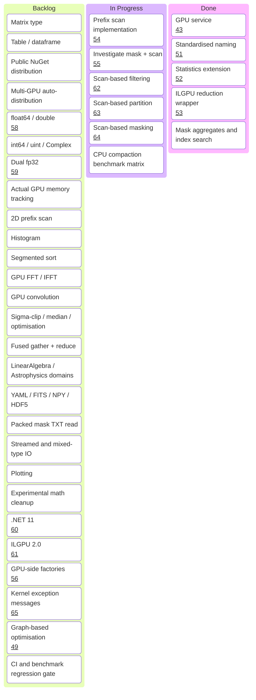

# BAVCL Roadmap

This roadmap is more of a list of ideas, rather than a strict plan.
It is mainly intended for me to keep track of cool ideas and nice to haves while developing.

## Roadmap item notes

The Kanban labels are intentionally short. These notes preserve the intended scope and
motivation for each item.

### Backlog

- **Matrix type** — Provide a dedicated matrix abstraction for full linear algebra. Until
  then, 2D `Vector` values (`Columns > 1`) cover the current matrix-like use cases.
- **Table / dataframe** — Add columnar, named data structures for tabular and dataframe-style
  workflows.
- **Public NuGet distribution** — Package and publish BAVCL for normal consumer use; the
  project currently uses a source-only project reference.
- **Multi-GPU auto-distribution** — Automatically distribute work across devices, including
  cross-device transfers when operands do not share a device. Manual device selection comes
  first.
- **float64 / double** — Add a first-class double-precision vector type without silently
  widening existing buffers. See issue #58.
- **int64 / uint / Complex** — Add specialized support for 64-bit integers, unsigned
  integers, and complex values where ILGPU's unmanaged constraints permit it.
- **Dual fp32** — Investigate a dual/split-precision representation for calculations that
  need more precision while retaining fp32 GPU throughput. See issue #59.
- **Actual GPU memory tracking** — Replace or complement `sizeof(T) × length` estimates with
  device-reported allocation and usage information.
- **2D prefix scan** — Investigate a genuinely efficient 2D scan path using ILGPU's
  `MultiPassScanKernel` and related `ScanExtensions` APIs. The current row-wise path runs
  one `RunSegmentScan` per row; compare throughput, temporary storage, and synchronization
  cost before replacing it.
- **Histogram** — Add GPU histogram/binning operations, with suitable handling for ranges,
  bins, and accumulation.
- **Segmented sort** — Generalize sorting beyond the current 2D row-oriented `SortAscX`
  implementation.
- **GPU FFT / IFFT** — Provide GPU Fourier transforms for FALCON spectral processing,
  particularly HPF dust determination.
- **GPU convolution** — Add convolution with variable Gaussian kernels for spectral
  resolution downgrade workflows.
- **Sigma-clip / median / optimisation** — Add GPU sigma clipping, median/percentile
  operations that avoid a full sort where possible, and optimization methods such as PSO or
  grid search for iterative fitting.
- **Fused gather + reduce** — Fuse variable index-pair gathering and reduction per model row
  for the spectral fitting pipeline; the public API is not yet specified.
- **LinearAlgebra / Astrophysics domains** — Add dedicated kernel domains for broader linear
  algebra and FALCON cosmological integrals beyond the current Arithmetic coverage.
- **YAML / FITS / NPY / HDF5** — Add configuration and scientific-data interchange formats,
  especially for FALCON spectral data.
- **Packed mask TXT read** — Support reading packed mask representations from text files.
- **Streamed and mixed-type IO** — Support chunked/forward-only reads and writes, including
  files containing mixed values such as `Vector`, `Vector3`, and `Mask`.
- **Plotting** — Add cross-platform debugging and inspection plots after the current
  `System.Drawing` prototype has been removed.
- **Experimental math cleanup** — Reduce `Source/Experimental/TestCls.cs` to one
  implementation per function and add accuracy coverage.
- **.NET 11** — Evaluate .NET 11 discriminated unions for reducing operation and kernel
  boilerplate. See issue #60.
- **ILGPU 2.0** — Track and evaluate the ILGPU 2.0 upgrade for compatibility and useful
  runtime/kernel improvements. See issue #61.
- **GPU-side factories** — Add GPU-side factory support where constructing values in kernels
  is useful and safe. See issue #56.
- **Kernel exception messages** — Improve diagnostics when kernel execution fails so the
  failing operation and relevant context are clear. See issue #65.
- **Graph-based optimisation** — Investigate graph-based execution/optimization to reduce
  repeated dispatch and synchronization overhead. See issue #49.
- **CI and benchmark regression gate** — Run tests and representative benchmarks in CI and
  detect performance regressions rather than relying only on functional checks.

### In Progress

- **Prefix scan implementation** — Provide inclusive and exclusive cumulative sum/product
  operations, including allocating, in-place, and GPU-synchronizing variants for `Vector`
  and `VectorInt`. See issue #54.
- **Investigate mask + scan** — Establish how packed mask flags and scan primitives should
  work together for compaction and index generation. See issue #55.
- **Scan-based filtering** — Use exclusive prefix scans over broadcast-compatible flags to
  implement device-side `Filter` without serial host compaction. See issue #62.
- **Scan-based partition** — Use scan-derived positions to split selected and unselected
  values efficiently on the device. See issue #63.
- **Scan-based masking** — Use scan-based compaction for mask application while preserving
  broadcast and fill-value semantics. See issue #64.
- **CPU compaction benchmark matrix** — Compare direct loops with the previous delegate-based
  implementations across flat and matrix layouts, row broadcasting, input sizes, and mask
  densities. Keep only changes that show a measured improvement.

### Done

- **GPU service** — Central GPU service and device/kernel management foundation. See issue
  #43.
- **Standardised naming** — Consistent public and internal naming across the API. See issue
  #51.
- **Statistics extension** — Expanded statistics functionality and reduction support. See
  issue #52.
- **ILGPU reduction wrapper** — Shared reduction wrapper infrastructure for GPU operations.
  See issue #53.
- **Mask aggregates and index search** — Mask `Any`, `All`, `CountTrue`, and first/last true
  index functionality.
